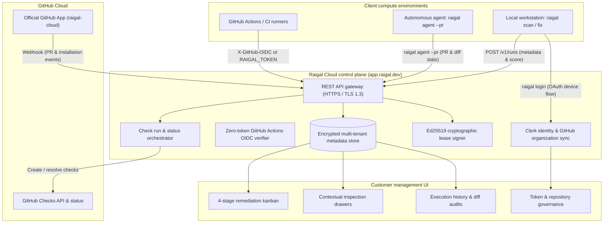

Raigal Cloud (`https://app.raigal.dev`) is the web application and coordination service for Raigal. It manages pull request status checks, tracks findings on remediation boards, authenticates developers, and signs offline licenses.

## System topology

## Source code handling and privacy

Full customer source code is never sent to, processed by, or stored on Raigal Cloud servers.

Separation between client compute and cloud control plane:
1. **Local and runner execution**: AST parsing, linters (oxlint, ruff, biome), complexity checks, and pattern rules execute entirely inside your local workstation or CI runner.
2. **Diagnostic reporting**: When a scan completes, only summary diagnostics are transmitted:
   - Quality score (0-100) and category breakdowns
   - Rule IDs (such as `ai-slop/trivial-comment` and `security/eval`)
   - Relative file paths and line coordinates
   - Summary diff metrics (files changed, additions, deletions)
3. **Pull request diff previews**: During pull request CI evaluations, a git patch diff preview (capped at 20 KB) is transmitted to display modified lines in the pull request dashboard. Before transmission, this preview passes through `maskSecrets`, which strips authorization headers, access tokens, private keys, and common credential patterns.

## GitHub App integration

Raigal connects with GitHub through the official `raigal-cloud` app:

- **Webhook status checks**: When a pull request opens or updates, GitHub notifies Raigal Cloud, which registers a pending "Raigal Quality Gate" check on the commit SHA.
- **Check resolution**: After the CI runner finishes the scan, it reports the score back to Raigal Cloud. Raigal then marks the check as passed or failed, resolving required branch protection rules.
- **Lifecycle events**: PR merges and closures are delivered via GitHub webhooks, keeping board status current without custom cleanup scripts.
- **Safety timeout**: If a CI job is cancelled or interrupted, Raigal Cloud automatically clears pending checks after 20 minutes to prevent PRs from being blocked indefinitely.

## Authentication and access control

### Multi-tenant organization isolation
Raigal Cloud isolates tenant data using Clerk identity. Repositories, scan records, findings, and tokens are partitioned by organization ID. Organizations operate under a 14-day fully-featured evaluation trial during pilot onboarding, or with enterprise licenses.

### GitHub Actions OIDC
For CI workflows, runners authenticate using ephemeral GitHub tokens:
- The runner requests a short-lived OIDC token from `token.actions.githubusercontent.com`.
- The runner sends the token in the `X-GitHub-OIDC` header to `/v1/runs`.
- Raigal validates the token signature and verifies that the repository owner matches your organization.
- Once verified, the runner is granted one-time access to record that run.

### Developer CLI login (RFC 8628)
Developers log in from the terminal with `raigal login`. This uses the OAuth 2.0 Device Authorization flow (RFC 8628), opening a browser window to approve the session.

### Offline tolerance and air-gapped environments
Raigal supports disconnected operation across two tiers:
- **72-hour offline leases**: For local development and travel, authenticated workstations cache a signed Ed25519 lease token valid for 72 hours. The CLI verifies this signature offline using a public key embedded in the binary.
- **True air-gap static licenses**: For isolated networks, sovereign VPCs, or CI runners with no outbound internet access, Raigal supports offline license tokens (valid for 1 to 3 years) with no phone-home requirement, as well as self-hosted control plane deployments.

## Repository management

Administrators manage repository data in **Settings** > **Repositories**:
- View all synchronized repositories and active branches.
- Adjust quality policy baselines per repository.
- Regenerate or revoke CI access tokens.
