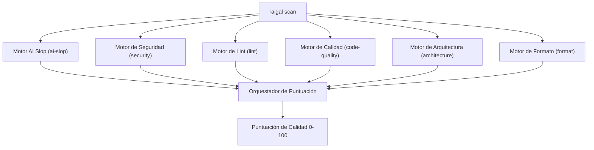

Raigal ejecuta seis motores de diagnóstico especializados en paralelo durante cada análisis:



## Motores de diagnóstico integrados

1. **`security`** (Peso: 1.5): detecta credenciales expuestas en código, fugas de secretos, superficies de inyección en prompts de LLMs, herramientas de agentes sin aislamiento en sandbox, inyecciones SQL o de shell y dependencias vulnerables.
2. **`ai-slop`** (Peso: 1.0): analiza más de 50 reglas especializadas en 6 lenguajes (TypeScript/JavaScript, Python, Go, Rust, C#, C++), como excepciones silenciadas, comentarios narrativos repetitivos, aserciones de tipo laxas y stubs incompletos.
3. **`architecture`** (Peso: 1.0): valida límites entre módulos y detecta dependencias circulares.
4. **`code-quality`** (Peso: 0.8): localiza código y exportaciones sin uso (mediante Knip), complejidad ciclomática excesiva, anidamiento profundo y límites de parámetros.
5. **`lint`** (Peso: 0.6): ejecuta análisis estático multilingüe en TypeScript/JavaScript (Oxlint), Python (Ruff), Rust (Clippy), Go, C# (Roslynator, InspectCode), C++ (Clang-Tidy, Cppcheck) y Ruby.
6. **`format`** (Peso: 0.3): revisa formato, sangrado, espacios en blanco y orden de importaciones.

## Niveles de impacto de las reglas

Cada regla se clasifica en un nivel de impacto que define su multiplicador de deducción y su tope máximo en el repositorio:

| Nivel | Multiplicador | Tope por defecto | Tipos de hallazgos habituales |
|---|---|---|---|
| `strict` | `1.0x` | Sin tope (`maxPerRule`) | Secretos filtrados, inyección en prompts, excepciones silenciadas |
| `standard` | `1.0x` | Sin tope (`maxPerRule`) | Diagnósticos estándar de linters y comprobaciones fiables de defectos |
| `maintainability` | `0.75x` | 24 | Complejidad ciclomática alta, funciones excesivamente largas |
| `mechanical` | `0.5x` | 16 | Importaciones no utilizadas, variables locales sin referencia |
| `style` | `0.5x` | 8 | Variaciones de formato, comentarios triviales |
| `advisory` | `0.25x` | 8 | Auditorías omitidas y avisos informativos |

## Catálogo de reglas habituales

| Identificador de regla | Motor | Severidad | Qué detecta | Corrección automática |
|---|---|---|---|---|
| `ai-slop/swallowed-exception` | `ai-slop` | Warning | Bloque catch que oculta un error sin gestionarlo ni relanzarlo | No (Agente) |
| `ai-slop/trivial-comment` | `ai-slop` | Warning | Comentarios que solo repiten declaraciones obvias de funciones | Sí (`raigal fix`) |
| `ai-slop/narrative-comment` | `ai-slop` | Warning | Bloques extensos de comentarios que describen el razonamiento del modelo | Sí (`raigal fix`) |
| `ai-slop/unsafe-type-assertion` | `ai-slop` | Warning | Aserciones de tipo (`as any`, `as unknown as T`) que eluden la comprobación de tipos | No (Agente) |
| `ai-slop/constant-condition` | `ai-slop` | Warning | Expresiones condicionales que siempre evalúan a true o false | No (Agente) |
| `ai-slop/todo-stub` | `ai-slop` | Warning | Comentarios TODO, FIXME o stubs que dejan comportamiento sin implementar | No (Agente) |
| `ai-slop/thin-wrapper` | `ai-slop` | Warning | Funciones que solo pasan argumentos sin aportar lógica ni contrato claro | No (Agente) |
| `ai-slop/unused-import` | `ai-slop` | Warning | Módulos o símbolos importados que nunca se utilizan en el archivo | Sí (`raigal fix`) |
| `security/prompt-injection` | `security` | Error | Interpolación dinámica de variables no sanitizadas en prompts de sistema | No (Agente) |
| `security/unsandboxed-agent-tool` | `security` | Error | Herramienta de agente que ejecuta comandos en el host sin contenedor ni confirmación | No (Agente) |
| `security/hardcoded-secret` | `security` | Error | Claves privadas, tokens o contraseñas incrustadas directamente en código | No |
| `security/eval` | `security` | Error | Ejecución dinámica de código (`eval`, `new Function`) a partir de entradas de usuario | No |
| `code-quality/duplicate-block` | `code-quality` | Warning | Bloques de código repetidos que duplican lógica entre módulos | No (Agente) |

## Ajustes de severidad de reglas

En `.raigal/config.yml` puede configurar severidades personalizadas o desactivar reglas por completo:

```yaml
rules:
  ai-slop/trivial-comment: "off"
  ai-slop/unsafe-type-assertion: "error"
  ai-slop/constant-condition: "warning"
```

Los valores admitidos son `"error"`, `"warning"` y `"off"`. Desactivar una regla (`"off"`) suprime su análisis y elimina cualquier deducción asociada de la puntuación.
