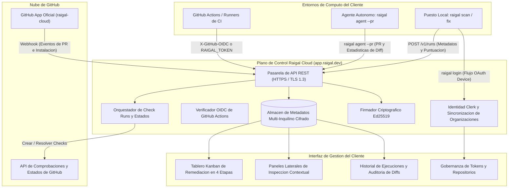

Raigal Cloud (`https://app.raigal.dev`) es la aplicacion web y servicio de coordinacion de Raigal. Gestiona comprobaciones de pull requests, organiza incidencias en tableros de remediacion, autentica a los usuarios y firma licencias fuera de linea.

## Topologia del sistema

## Tratamiento del codigo fuente y privacidad

Los archivos de codigo fuente completos del cliente nunca se envian, procesan ni almacenan en los servidores de Raigal Cloud.

Separacion entre computo local y servicios en la nube:
1. **Ejecucion local y en runners**: El analisis sintactico (AST), linters (oxlint, ruff, biome), analisis de complejidad y deteccion de patrones se ejecutan integramente en su maquina o runner de CI.
2. **Informes de diagnostico**: Al terminar el escaneo, solo se transmiten resumenes diagnosticos:
   - Puntuacion final (0-100) y desglose por categorias
   - Identificadores de reglas (como `ai-slop/trivial-comment` o `security/eval`)
   - Rutas relativas de archivos y coordenadas de linea
   - Metricas de diff (archivos modificados, lineas añadidas y eliminadas)
3. **Vistas previas de diff en pull requests**: Durante la evaluacion de pull requests en CI, se envia una vista previa del parche unificado (limitada a 20 KB) para visualizar las lineas modificadas en el tablero de pull requests. Antes de transmitirse, este diff pasa por `maskSecrets`, que elimina cabeceras de autorizacion, tokens Bearer, claves privadas y patrones de credenciales habituales.

## Integracion con la GitHub App

Raigal se conecta con GitHub mediante la app oficial `raigal-cloud`:

- **Comprobaciones basadas en eventos**: Al abrir o actualizar un pull request, GitHub notifica a Raigal Cloud, que crea un check pendiente "Raigal Quality Gate" en el commit head.
- **Resolucion de comprobaciones**: Tras la evaluacion en CI, el runner envia la puntuacion a Raigal Cloud. Raigal marca el check como aprobado o rechazado, resolviendo las reglas de proteccion de rama.
- **Eventos de ciclo de vida**: Las fusiones y cierres se reciben mediante webhooks de GitHub, manteniendo el tablero actualizado sin scripts adicionales.
- **Tiempo limite de seguridad**: Si un trabajo de CI se cancela o interrumpe, Raigal Cloud elimina comprobaciones huerfanas tras 20 minutos para no bloquear pull requests.

## Autenticacion y control de accesos

### Aislamiento multi-inquilino
Raigal Cloud aisla los datos de cada organizacion mediante Clerk. Repositorios, ejecuciones, hallazgos y tokens de API se particionan por identificador de organizacion. Las organizaciones operan bajo un periodo de prueba de evaluacion de 14 dias durante pilotos, o con licencias empresariales.

### OIDC en GitHub Actions
Para flujos de CI, los runners se autentican con tokens efimeros:
- El runner solicita un token OIDC a `token.actions.githubusercontent.com`.
- El runner envia el token en la cabecera `X-GitHub-OIDC` a `/v1/runs`.
- Raigal verifica la firma y valida que el repositorio pertenece a su organizacion.
- Tras la validacion, se concede permiso temporal para registrar esa ejecucion concreta.

### Autenticacion del CLI (RFC 8628)
Los desarrolladores inician sesion con `raigal login`. El comando utiliza el flujo OAuth 2.0 Device Authorization (RFC 8628), abriendo una ventana del navegador para autorizar el equipo.

### Tolerancia sin conexion y entornos aislados (Air-Gap)
Raigal admite dos niveles de operacion sin conexion continua:
- **Licencias temporales fuera de linea (72 horas)**: Para desarrollo local y desplazamientos, los equipos autenticados guardan una licencia firmada con Ed25519 valida durante 72 horas. El CLI valida la firma en local con una clave publica incrustada en el binario.
- **Licencias estaticas para redes aisladas**: Para redes completamente desconectadas o runners en VPCs sin salida a internet, Raigal admite tokens de licencia estaticos (validos de 1 a 3 años) sin necesidad de conexion externa, asi como despliegues del plano de control en infraestructura propia.

## Gestion de repositorios

Los administradores gestionan los repositorios desde **Settings** > **Repositories**:
- Las claves de API se almacenan con hash SHA-256; los valores en texto plano nunca se guardan en la base de datos.
- Al eliminar un repositorio, se borran en cascada todos sus registros historicos de ejecuciones, tarjetas de pull request y hallazgos.
