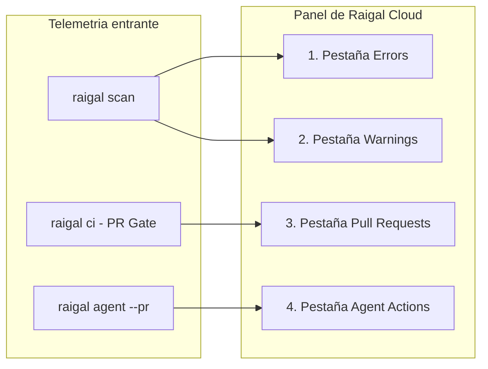

Raigal Cloud (`https://app.raigal.dev`) unifica los datos de escaneo procedentes de ejecuciones locales, pipelines de CI y webhooks de la GitHub App en una interfaz centralizada de remediacion.

## Estructura del panel

La interfaz organiza el estado del repositorio en cinco areas principales:

### 1. Cabecera del repositorio

La barra superior muestra el contexto en tiempo real del proyecto seleccionado:
- **Selector de repositorio**: Permite alternar entre repositorios autorizados o filtrar por nombre.
- **Selector de ramas**: Cambia entre ramas (`main`, `develop`, ramas de funcionalidad) para inspeccionar incidencias especificas.
- **Insignia de puntuacion de salud**: Muestra la puntuacion numerica actual de 0 a 100 con un indicador de color segun la banda. Raigal emplea estrictamente valores numericos sin calificaciones por letras.
- **Marca temporal relativa**: Indica cuando finalizo el ultimo analisis.
- **Recuento de hallazgos**: Numero total de incidencias activas en la rama seleccionada.
- **Boton de actualizacion**: Solicita los datos mas recientes de escaneo.

<Info>
  Los escaneos enviados a la rama principal (`main` / `develop`) establecen la linea base del repositorio reflejada en las pestañas **Errors** y **Warnings**. Los escaneos incrementales de PRs se registran en la pestaña **Pull Requests**.
</Info>

### 2. Barra lateral y acciones rapidas

La barra lateral izquierda gestiona la navegacion del espacio de trabajo:
- **Navegacion principal**: Accesos directos a Overview, Activity, Settings y Docs.
- **Acciones rapidas (`Cmd + K` o `Ctrl + K`)**: Abre la paleta de comandos para buscar repositorios, cambiar de rama o copiar comandos del CLI.
- **Faceta de infracciones frecuentes**: Enumera las seis reglas con mayor numero de avisos activos junto con su severidad y recuento. Al pulsar sobre una regla, la vista filtra las tarjetas inmediatamente.

### 3. Etapas de hallazgos

El panel central divide las incidencias en cuatro pestañas especializadas:

#### Errors
- Incidencias de alta severidad: vulnerabilidades de seguridad (`security/hardcoded-secret`, `security/eval`), excepciones silenciadas (`ai-slop/swallowed-exception`) y fallos estrictos de compilador o linter.
- Detalles: rutas relativas, coordenadas de linea, descripcion de la regla e insignias de severidad.
- Acciones: seleccion de tarjeta para abrir el panel de vulnerabilidad o copiar comandos de correccion.

#### Warnings
- Avisos no bloqueantes: problemas de estilo (`ai-slop/trivial-comment`), duplicacion de codigo (`code-quality/duplicate-block`), stubs incompletos (`ai-slop/todo-stub`) y advertencias de mantenibilidad (`ai-slop/unsafe-type-assertion`).
- Acciones: copia directa del comando de correccion (`npx @methiu/raigal fix`) para aplicar arreglos automaticos seguros.

#### Pull Requests
- Solicitudes de cambios evaluadas por `raigal ci` o por la GitHub App.
- Insignias de estado (puerta de calidad en 3 estados):
  - `Passed [puntuacion]`: cumple `ci.failBelow` con 0 errores y 0 advertencias.
  - `Passed (With Warnings) [puntuacion]`: cumple `ci.failBelow` sin errores bloqueantes, pero con advertencias consultivas.
  - `Failed [puntuacion]`: la puntuacion queda por debajo del umbral o contiene errores bloqueantes.
  - `Pending`: analisis en curso o a la espera del runner de CI.
- Filtros: filtrado inmediato por resultado del control de calidad (`Passed` o `Failed`).

#### Agent Actions
- Pull requests generados durante sesiones de reparacion autonoma con agentes (`raigal agent --pr`).
- Detalles del resumen:
  - Insignia del proveedor: identifica el agente utilizado (`claude`, `codex`, `opencode`).
  - Diferencia de puntuacion: muestra la mejora conseguida (por ejemplo, `71 -> 89 (+18 pts)`).
  - Diff del parche: muestra el diff unificado verificado en el worktree aislado.

### 4. Filtros facetados

Situada junto al listado de tarjetas, la barra de filtros permite acotar grandes volumenes de incidencias:
- **Faceta de motor**: Filtra incidencias segun el motor de diagnostico (`security`, `ai-slop`, `lint`, `code-quality`, `format`, `architecture`).
- **Faceta de carpeta**: Aisla las incidencias a subdirectorios concretos (como `src/api` o `packages/core`).
- **Faceta de control de calidad**: Filtra registros de pull requests segun su resultado (`Passed` o `Failed`).

### 5. Paneles deslizantes de inspeccion

Al pulsar sobre una tarjeta se despliega un panel lateral con informacion detallada:

<table>
  <thead>
    <tr>
      <th>Panel</th>
      <th>Contenido</th>
      <th>Accion principal</th>
    </tr>
  </thead>
  <tbody>
    <tr>
      <td><strong>Panel de vulnerabilidad</strong></td>
      <td>Identificador de regla, motor, ruta de archivo, linea, fragmento de codigo y guia de remediacion.</td>
      <td><code>Copy CLI Fix</code>: copia el comando de correccion determinista al portapapeles.</td>
    </tr>
    <tr>
      <td><strong>Panel de pull request</strong></td>
      <td>Nombre de rama, autor, variacion de puntuacion, registros de CI e incidencias bloqueantes.</td>
      <td><code>Copy git checkout</code>: copia el comando para clonar o cambiar a la rama.</td>
    </tr>
    <tr>
      <td><strong>Panel de agente</strong></td>
      <td>Proveedor del agente, turnos empleados, progresion de puntuacion y parche unificado completo.</td>
      <td><code>Copy gh merge</code>: copia el comando de GitHub CLI para fusionar la PR del agente.</td>
    </tr>
  </tbody>
</table>

## Rangos de salud de la puntuacion

El panel clasifica las puntuaciones en cuatro bandas de salud calibradas:

| Rango de puntuacion | Banda en panel web | Color identificativo | Estado del control de calidad |
|---|---|---|---|
| 90 - 100 | `Excellent` | Verde lima | Aprobado |
| 75 - 89 | `Good` | Verde esmeralda | Aprobado (supera el umbral por defecto de 75) |
| 50 - 74 | `Needs Work` | Ambar / amarillo | Requiere atencion (no alcanza el umbral) |
| < 50 | `Critical` | Rojo | Falla el control de calidad |

En la salida de la terminal, el CLI simplifica estos rangos en tres estados operativos: `Healthy` (75 o superior), `Needs Work` (50 a 74) y `Critical` (inferior a 50). No se utilizan letras (A-E).

## Configuracion de la organizacion

En **Settings** (`app.raigal.dev/settings`), los administradores gestionan el acceso:
- **Repositories**: Consulta repositorios sincronizados, configura permisos de la GitHub App o elimina proyectos que ya no se monitorizan.
- **API Tokens**: Genera o revoca claves de organizacion (`rgl_live_...`).
- **Members**: Administra accesos de equipo y autenticacion corporativa (SSO).
