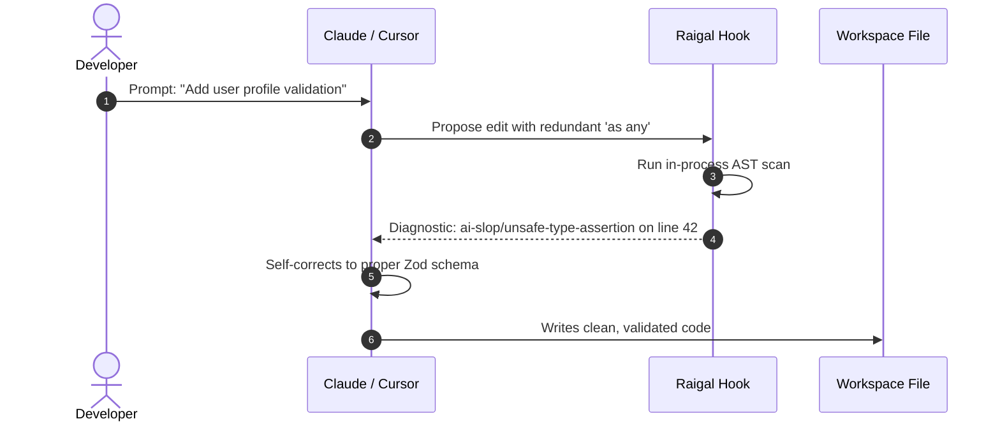

# Agent interception hooks

Raigal can inspect code edits proposed by AI coding agents before they are saved to disk.

## How hooks work

When a coding agent modifies a file:
1. The hook executes a scoped in-memory AST scan on the changed files via `runScopedScan`.
2. Heavy processes (network audits, type-checking, and formatters) are skipped to keep turn latency low.
3. If the edit introduces pattern violations (such as swallowed exceptions or unsafe type assertions), the hook returns structured feedback into the agent turn.
4. The agent reads the machine-readable feedback and can self-correct within the same turn.



## Installing hooks

Install hooks for all detected agents on your system:

```bash
raigal hook install
```

Or target specific tools:

```bash
raigal hook install --claude
raigal hook install --cursor
raigal hook install --gemini
```

Pass `--project` to scope hooks to the current repository only instead of your global user directory.

## Status, baselines, and safety

### Status and sentinel integrity
Check active hooks and verified SHA-256 sentinel hashes:

```bash
raigal hook status
```

### Capturing baselines
Record pre-existing technical debt before running incremental checks:

```bash
raigal hook baseline
```

This writes a fingerprint snapshot to `.raigal/baseline.json`. Subsequent agent edits are evaluated using 3-stage baseline matching, ensuring pre-existing debt does not trigger false regressions.

### Safe uninstallation
Remove hooks cleanly without disturbing hand-written editor settings:

```bash
raigal hook uninstall
```


To connect Raigal tools directly to your agent tool-calling loop instead of relying on file system hooks, see the [Raigal MCP Server](../automation-and-ci-cd/mcp-server.md).

