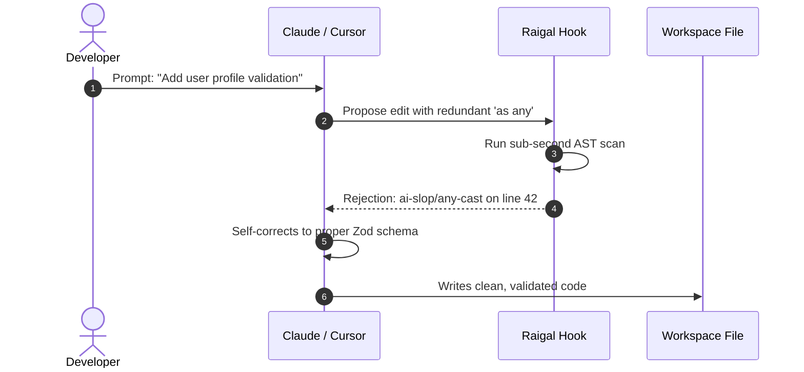

# Agent interception hooks

Raigal can inspect code edits proposed by AI coding agents before they are saved to disk.

## How hooks work

When a coding agent modifies a file:
1. The hook runs a localized AST scan on the modified buffer.
2. If the edit introduces pattern violations, such as redundant null checks or stripped error handling, the hook rejects the edit or emits a warning.
3. The agent receives the diagnostic output in its context and adjusts its proposal.



## Installing hooks

Install hooks for all detected agents on your system:

```bash
raigal hook install
```

Or target specific tools:

```bash
raigal hook install claude cursor opencode
```

## Status and baselines

Check active hooks:

```bash
raigal hook status
```

Record the current score as the project baseline:

```bash
raigal hook baseline
```

Subsequent agent edits that drop the score below this baseline are rejected.


To connect Raigal tools directly to your agent's tool-calling loop instead of relying on file system hooks, see the [Raigal MCP Server](../automation-and-ci-cd/mcp-server.md).

