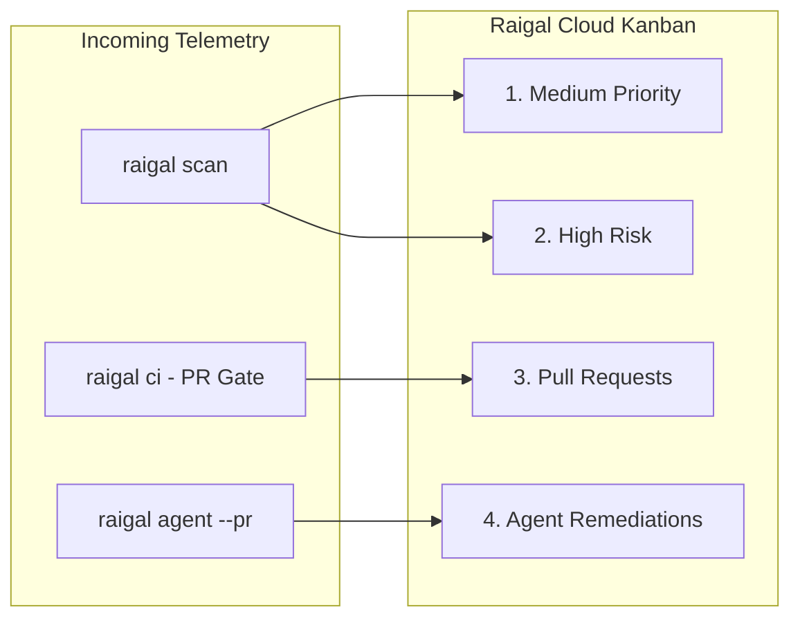

# Remediation board and telemetry

Raigal Cloud (`https://app.raigal.dev`) displays code quality metrics and pending issues across a four-column remediation board.

## The four board columns

The board groups findings into four columns:

### 1. Medium Priority
- Items: non-blocking warnings, style discrepancies, minor dead code, and low-severity pattern issues (trivial comments, redundant null checks).
- Actions: copy the automated fix command (`npx @methiu/raigal fix --rule <rule-id>`).
- Details: select a card to open its drawer with code snippets and line numbers.

### 2. High Risk
- Items: blockers that fail CI gates, exposed credentials, SQL or command injection risks, unsafe type casts (`as any`), and empty catch blocks (`silent-catch`).
- Actions: review rule documentation and remediation guidance.

### 3. Pull Requests (CI gates)
- Items: open pull requests evaluated by the Raigal Quality Gate in CI or through GitHub App webhooks.
- Badges:
  - `PASSED [score]`: meets or exceeds the configured quality threshold.
  - `BLOCKED [score]`: contains blocking violations or falls below the minimum score.
  - `IN REVIEW / PENDING`: waiting for CI evaluation.
  - `MERGED`: merged into the base branch.
  - `CLOSED`: closed without merging.
- Updates: successive pushes to the same PR update the existing card in place.

### 4. Agent Remediations (`--pr`)
- Items: pull requests opened by coding agents (`raigal agent --provider <opencode|claude|codex> --pr`).
- Details:
  - Provider badge: identifies the authoring agent (`opencode`, `claude`, `codex`).
  - Score change: shows before and after scores (such as `72 -> 88 (+16 pts)`).
  - Patch diff: shows the unified diff generated in the repair worktree.

## Inspection drawers

Selecting a card opens a slide-over panel with details:

<table data-view="cards">
  <thead>
    <tr>
      <th>Drawer</th>
      <th>Content</th>
      <th>Action</th>
    </tr>
  </thead>
  <tbody>
    <tr>
      <td><strong>Vulnerability drawer</strong></td>
      <td>Rule ID, engine, line number, file path, and explanation.</td>
      <td><code>Copy CLI Fix</code>: copies the fix command.</td>
    </tr>
    <tr>
      <td><strong>Pull request drawer</strong></td>
      <td>Branch, author, score, CI gate logs, and blocking findings.</td>
      <td><code>Copy git checkout</code>: copies the checkout command.</td>
    </tr>
    <tr>
      <td><strong>Agent drawer</strong></td>
      <td>Agent provider, before and after score, and unified patch diff.</td>
      <td><code>Copy gh merge</code>: copies the GitHub CLI merge command.</td>
    </tr>
  </tbody>
</table>

## Repository management

In **Settings** (`https://app.raigal.dev/settings`), administrators can manage repositories and tokens:

### Repository selector and branch filter
- Use the header menu to switch between tracked repositories.
- Use the branch dropdown to view metrics for specific branches (`main`, `develop`, feature branches).
- Filter settings are preserved in deep links: `/repos/:repoId?branch=feat/auth&drawer=vuln&id=...`.

### Removing repositories
To remove a repository that is no longer monitored:
1. Open **Settings** > **Repositories**.
2. Find the repository in the list.
3. Select **Remove**.
4. Confirm deletion.


Deleting a repository permanently removes all associated scan runs, scores, pull request evaluations, and finding cards.


### API tokens
- Create tokens for different CI runners or teams.
- Revoke tokens that are no longer needed.

## Command palette (`⌘ K`)

Raigal Cloud includes a search palette:
- Press `⌘ K` (or `Ctrl K` on Windows/Linux).
- Search repositories and branches.
- Jump to documentation pages.
- Copy CLI scan and fix commands.
- Trigger manual repository sync with GitHub.
