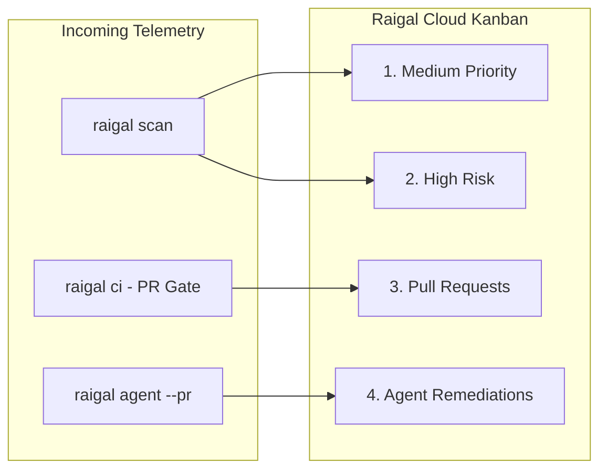

# Remediation Kanban & Telemetry

Raigal Cloud (`https://app.raigal.dev`) provides an interactive, density-aware Kanban dashboard that translates code-quality telemetry into prioritized developer workflows.

---

## The 4-Stage Kanban Board

The Remediation Board organizes your repository's findings across four specialized columns:

### 1. Medium Priority
- **Focus:** Non-blocking warnings, style issues, minor dead code, and low-severity AI slop patterns (trivial comments, redundant null checks).
- **Actions:** Quick 1-click copy of the deterministic autofix command (`npx @methiu/raigal fix --rule <rule-id>`).
- **Inspection:** Clicking any card opens the slide-over inspection drawer with full code snippets and line numbers.

### 2. High Risk
- **Focus:** Critical blockers that fail CI gates, exposed API secrets, SQL/command injections, unsafe typecasts (`as any`), and empty exception handlers (`silent-catch`).
- **Actions:** Highlighted critical badges with deterministic remediation guidance.

### 3. Pull Requests (CI Gates)
- **Focus:** Active Pull Requests evaluated by the Raigal Quality Gate in GitHub Actions or GitHub App webhooks.
- **Status Badges:**
  - `PASSED [score]`: PR meets or exceeds the configured quality threshold (score renders when evaluated).
  - `BLOCKED [score]`: PR contains blocking violations or falls below the minimum score.
  - `IN REVIEW / PENDING`: PR is open and waiting for CI evaluation (instantly created by the GitHub App).
  - `MERGED`: PR has been merged into the base branch (automatically updated via GitHub App webhook).
  - `CLOSED`: PR was closed without merging.
- **Idempotency & Isolation:** Sequential pushes on the same PR update the card in-place. Out-of-order webhook delivery is guarded so newer telemetry is never overwritten by stale runs. Standard PRs and autonomous agent remediations are cleanly segregated.

### 4. Agent Remediations (`--pr`)
- **Focus:** Pull requests autonomously generated by AI coding agents (`raigal agent --provider <opencode|claude|codex> --pr`).
- **Telemetry:**
  - **Provider Badge:** Identifies the authoring agent (`opencode`, `claude`, `codex`, or custom orchestrators).
  - **Score Improvement:** Displays measured before/after score deltas (e.g., `72 → 88 (+16 pts)`).
  - **Patch Diff:** Shows exact unified diffs generated and verified inside isolated git worktrees.

---

## Slide-Over Contextual Inspection Drawers

Every card on the board can be clicked to open a detailed slide-over panel:

<table data-view="cards">
  <thead>
    <tr>
      <th>Drawer</th>
      <th>Content</th>
      <th>Key Action</th>
    </tr>
  </thead>
  <tbody>
    <tr>
      <td><strong>Vulnerability Drawer</strong></td>
      <td>Rule ID, engine, line number, file path, and rule explanation.</td>
      <td><code>Copy CLI Fix</code> — Copies exact fix command to clipboard.</td>
    </tr>
    <tr>
      <td><strong>Pull Request Drawer</strong></td>
      <td>Branch name, author, score, CI gate logs, and blocking findings.</td>
      <td><code>Copy git checkout</code> — Copies branch checkout command.</td>
    </tr>
    <tr>
      <td><strong>Agent Details Drawer</strong></td>
      <td>Agent provider, before/after score comparison, and patch diff.</td>
      <td><code>Copy gh merge</code> — Copies 1-click GitHub merge command.</td>
    </tr>
  </tbody>
</table>

---

## Repository Governance & Management

From the **Settings Dashboard** (`https://app.raigal.dev/settings`), administrators can manage team access and repository lifecycles:

### 1. Active Repository Switcher & Branch Filtering
- Use the header selector to toggle between tracked repositories.
- Use the branch dropdown to switch between branches (e.g., `main`, `develop`, feature branches). The board instantly re-scopes metrics and cards to the selected branch.
- Deep links preserve workspace state: `/repos/:repoId?branch=feat/auth&drawer=vuln&id=...`.

### 2. Removing Decommissioned Repositories
If a repository is retired, renamed, or no longer monitored:
1. Navigate to **Settings** > **Repositories**.
2. Locate the repository in the list.
3. Click the **Remove** button (trash icon).
4. Confirm the deletion prompt.


Removing a repository permanently purges all historical scan runs, quality scores, Pull Request evaluations, and finding cards for that repository.


### 3. API Token Governance
- Mint granular tokens for different CI runners or developer teams.
- Revoke compromised or outdated tokens in one click.

---

## Navigation & Quick Actions (`⌘ K`)

Raigal Cloud features a global Command Palette for rapid navigation:
- Press `⌘ K` (or `Ctrl K` on Windows/Linux) anywhere in the dashboard.
- Quickly search across repositories and branches.
- Jump directly to documentation guides.
- Copy CLI scan and fix commands.
- Trigger manual GitHub repository synchronization.
