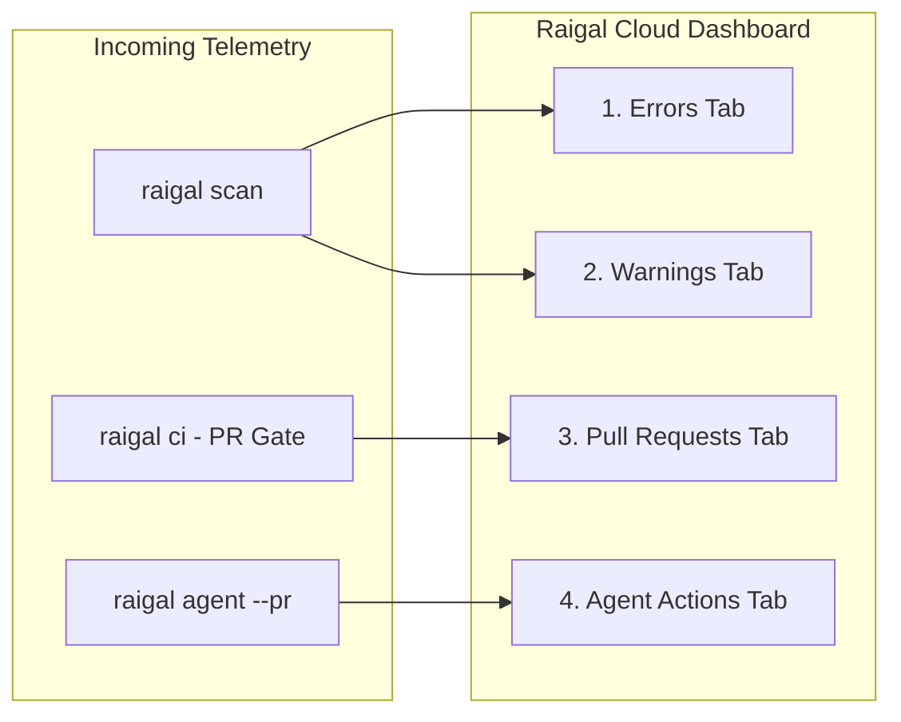

# Remediation dashboard and telemetry

Raigal Cloud (`app.raigal.dev`) aggregates scan telemetry from local developer runs, CI pipelines, and GitHub App webhooks into a unified remediation interface.

## Dashboard layout

The interface organizes codebase health into five key areas:

### 1. Repository header

The top header provides real-time context for the selected project:
- Repository selector: switch between authorized repositories or filter by slug.
- Branch switcher: toggle between branches (`main`, `develop`, feature branches) to inspect branch-specific findings.
- Health score badge: displays the current 0-100 numeric health score with color-coded band indicators. Raigal uses purely numeric scores without letter grades.
- Relative timestamp: indicates when the last scan run completed.
- Findings count: shows total active findings for the current branch.
- Refresh action: triggers a manual update from the latest scan telemetry.

### 2. Left sidebar and quick actions

The left sidebar handles workspace navigation:
- Primary navigation: direct links to Overview, Activity, Settings, and Documentation.
- Quick actions (`Cmd + K` or `Ctrl + K`): opens the command palette to search repositories, navigate branches, or copy CLI commands.
- Top violations facet: displays the six most frequent active rule violations with severity badges and occurrence counts. Selecting a rule filters the dashboard cards immediately.

### 3. Finding stages

The central board divides issues into four distinct tabs:

#### Errors
- High-severity findings: security vulnerabilities (`security/hardcoded-secret`, `security/eval`), swallowed exceptions (`ai-slop/swallowed-exception`), and strict compiler or linter errors.
- Card details: relative file paths, line coordinates, rule descriptions, and severity badges.
- Available actions: selecting a card opens the vulnerability drawer with remediation advice or copies the CLI fix command.

#### Warnings
- Non-blocking findings: style issues (`ai-slop/trivial-comment`), code quality findings (`code-quality/duplicate-block`), unfinished stubs (`ai-slop/todo-stub`), and maintainability items (`ai-slop/unsafe-type-assertion`).
- Available actions: copy the autofix command (`npx @methiu/raigal fix`) to apply safe automated cleanups.

#### Pull Requests
- Pull requests evaluated by `raigal ci` or the GitHub App.
- Status badges (3-state quality gate):
  - `Passed [score]`: score satisfies `ci.failBelow` with 0 errors and 0 warnings.
  - `Passed (With Warnings) [score]`: score satisfies `ci.failBelow` with 0 blocker errors, but advisory warnings exist.
  - `Failed [score]`: score fell below threshold or contains blocking errors.
  - `Pending`: scan in progress or awaiting CI runner completion.
- Filtering: filter pull request records by quality gate outcome (`Passed` or `Failed`).

#### Agent Actions
- Pull requests opened during autonomous agent remediation sessions.
- Summary details:
  - Provider badge: identifies the agent provider (`claude`, `codex`, `opencode`).
  - Score delta: displays before and after scores (such as `71 -> 89 (+18 pts)`).
  - Patch diff: shows the reviewed unified diff generated in the isolated worktree.

### 4. Facet filters

Located alongside the finding cards, the facet sidebar narrows down large finding lists:
- Engine facet: filter findings by diagnostic engine (`security`, `ai-slop`, `lint`, `code-quality`, `format`, `architecture`).
- Folder facet: isolate findings to specific subdirectories (such as `src/api` or `packages/core`).
- Quality gate facet: filter pull request records by `Passed` or `Failed` status.

### 5. Slide-over inspection drawers

Selecting any finding card opens a detailed slide-over panel:

<table data-view="cards">
  <thead>
    <tr>
      <th>Drawer</th>
      <th>Content</th>
      <th>Primary action</th>
    </tr>
  </thead>
  <tbody>
    <tr>
      <td><strong>Vulnerability drawer</strong></td>
      <td>Rule ID, engine, file path, line number, code snippet, and remediation guidance.</td>
      <td><code>Copy CLI Fix</code>: copies the deterministic autofix command to clipboard.</td>
    </tr>
    <tr>
      <td><strong>Pull request drawer</strong></td>
      <td>Branch name, author, score change, CI logs, and blocking findings.</td>
      <td><code>Copy git checkout</code>: copies the branch checkout command.</td>
    </tr>
    <tr>
      <td><strong>Agent drawer</strong></td>
      <td>Agent provider, turns taken, score progression, and complete unified patch.</td>
      <td><code>Copy gh merge</code>: copies the GitHub CLI command to merge the agent PR.</td>
    </tr>
  </tbody>
</table>

## Health score bands

The dashboard displays scores across four calibrated health tiers:

| Score range | Band | Indicator | Quality gate status |
|---|---|---|---|
| 90 - 100 | `Excellent` | Lime green | Passing |
| 75 - 89 | `Good` | Emerald green | Passing (meets default 75 threshold) |
| 50 - 74 | `Needs Work` | Amber / yellow | Failing default threshold |
| < 50 | `Critical` | Red | Failing |

In terminal output, the CLI simplifies these into three actionable states: `Healthy` (75 and above), `Needs Work` (50 to 74), and `Critical` (below 50). Letter grades (A-E) are never used.

## Organization settings

In **Settings** (`app.raigal.dev/settings`), administrators can manage team access:
- **Repositories**: view synced repositories, configure GitHub App permissions, or remove unmonitored repositories.
- **API tokens**: generate or revoke organization API keys (`rgl_live_...`).
- **Members and roles**: manage team members and Single Sign-On (SSO).
