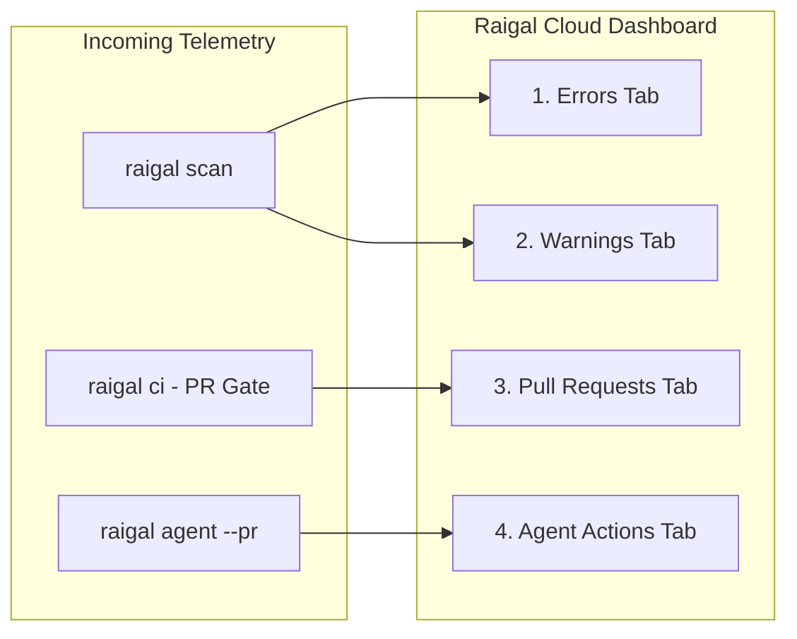

# Remediation dashboard and telemetry

Raigal Cloud (`app.raigal.dev`) aggregates scan telemetry from local developer runs, CI pipelines, and GitHub App webhooks into a unified remediation interface.

## Dashboard layout

The interface organizes codebase health into five key areas:

### 1. Repository header

The top header provides real-time context for the selected project:
- **Repository selector**: switch between authorized repositories or filter by name.
- **Branch switcher**: toggle between branches (`main`, `develop`, feature branches) to inspect branch-specific findings.
- **Health score badge**: displays the current 0–100 numeric health score with color-coded band indicators. Raigal uses purely numeric scores; letter grades (A–E) are not used.
- **Relative timestamp**: shows when the last scan run completed.
- **Findings count**: shows total active findings for the current branch.
- **Refresh action**: triggers a manual update from the latest scan telemetry.

### 2. Left sidebar and quick actions

The left sidebar handles workspace navigation:
- **Primary navigation**: quick links to **Overview**, **Activity**, **Settings**, and **Documentation**.
- **Quick actions (`⌘ K`)**: opens the command palette to search repositories, navigate branches, or copy CLI commands.
- **Top violations facet**: displays the six most frequent active rule violations with severity badges and occurrence counts. Selecting a rule filters the dashboard cards immediately.

### 3. Finding stages

The central board divides issues into four distinct tabs:

#### Errors
- **Items**: blocking issues, security vulnerabilities, leaked credentials, unsafe type assertions (`as any`), empty catch blocks (`silent-catch`), and strict compiler failures.
- **Details**: line numbers, rule descriptions, and severity badges.
- **Actions**: select a card to open the vulnerability drawer or copy automated fix commands.

#### Warnings
- **Items**: non-blocking warnings, style discrepancies, maintainability findings, minor dead code, and low-severity pattern issues (trivial comments, redundant null checks).
- **Actions**: copy single-rule autofix commands (`npx @methiu/raigal fix --rule <rule-id>`).

#### Pull Requests
- **Items**: pull requests evaluated by `raigal ci` or the GitHub App.
- **Status badges**:
  - `Passed [score]`: score satisfies `ci.failBelow` and contains zero blocking errors.
  - `Failed [score]`: score fell below threshold or contains blocking errors.
  - `Pending`: scan in progress or awaiting CI runner completion.
- **Filters**: quickly filter pull requests by quality gate outcome (`Passed` or `Failed`).

#### Agent Actions
- **Items**: pull requests opened by automated coding agents (`raigal agent --pr`).
- **Details**:
  - **Provider badge**: identifies the agent provider (`claude`, `codex`, `opencode`).
  - **Score delta**: displays before and after scores (such as `71 -> 89 (+18 pts)`).
  - **Patch diff**: shows the reviewed unified diff generated in the isolated worktree.

### 4. Facet filters

Located alongside the finding cards, the facet sidebar narrows down large finding lists:
- **Engine facet**: filter findings by diagnostic engine (`security`, `ai-slop`, `lint`, `code-quality`, `format`, `architecture`).
- **Folder facet**: isolate findings to specific subdirectories (such as `src/api` or `packages/core`).
- **Quality gate facet**: filter pull request records by `Passed` or `Failed` status.

### 5. Slide-over inspection drawers

Selecting any finding card opens a detailed slide-over panel:

<table data-view="cards">
  <thead>
    <tr>
      <th>Drawer</th>
      <th>Content</th>
      <th>Primary action</th>
    </tr>
  </thead>
  <tbody>
    <tr>
      <td><strong>Vulnerability drawer</strong></td>
      <td>Rule ID, engine, file path, line number, code snippet, and remediation guidance.</td>
      <td><code>Copy CLI Fix</code>: copies the deterministic autofix command to clipboard.</td>
    </tr>
    <tr>
      <td><strong>Pull request drawer</strong></td>
      <td>Branch name, author, score change, CI logs, and blocking findings.</td>
      <td><code>Copy git checkout</code>: copies the branch checkout command.</td>
    </tr>
    <tr>
      <td><strong>Agent drawer</strong></td>
      <td>Agent provider, turns taken, score progression, and complete unified patch.</td>
      <td><code>Copy gh merge</code>: copies the GitHub CLI command to merge the agent PR.</td>
    </tr>
  </tbody>
</table>

## Health score bands

The dashboard groups scores into five health bands:

| Score range | Band | Indicator |
|---|---|---|
| $90 - 100$ | `Excellent` | Lime green |
| $80 - 89$ | `Good` | Emerald green |
| $70 - 79$ | `Fair` | Amber / yellow |
| $60 - 69$ | `Poor` | Orange |
| $< 60$ | `Critical` | Red |

## Organization settings

In **Settings** (`app.raigal.dev/settings`), administrators can manage team access:
- **Repositories**: view synced repositories, configure GitHub App permissions, or remove unmonitored repositories.
- **API tokens**: generate or revoke organization API keys (`rgl_live_...`).
- **Members and roles**: manage team members and Single Sign-On (SSO).
