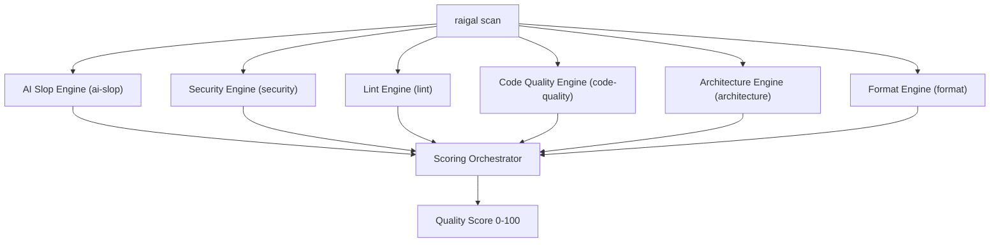

# Rules and engines

Raigal runs six diagnostic engines in parallel during each scan:



## Built-in diagnostic engines

1. **`security`** (Weight: 1.5): checks hardcoded credentials, secret leaks, prompt injection surfaces, unsandboxed agent tools, SQL/shell injections, and vulnerable dependencies.
2. **`ai-slop`** (Weight: 1.0): detects 26+ patterns left behind by coding agents, including swallowed exceptions, repetitive narrative comments, unsafe type casts, and unimplemented stubs.
3. **`architecture`** (Weight: 1.0): checks module boundary crossings and circular dependency graphs.
4. **`code-quality`** (Weight: 0.8): checks unused code and exports (via Knip), function complexity, nesting depth, and parameter limits.
5. **`lint`** (Weight: 0.6): runs static analysis across TypeScript/JavaScript (Oxlint), Python (Ruff), Rust (Clippy), Go, C# (Roslynator, InspectCode), C++ (Clang-Tidy, Cppcheck), and Ruby.
6. **`format`** (Weight: 0.3): validates formatting, whitespace, indentation, and import ordering.

## Rule impact tiers

Every rule is classified into an impact tier that determines its deduction multiplier and repository-wide cap:

| Tier | Multiplier | Baseline cap | Typical finding types |
|---|---|---|---|
| `strict` | $1.0\times$ | Uncapped (`maxPerRule`) | Leaked secrets, prompt injections, swallowed exceptions |
| `standard` | $1.0\times$ | Uncapped (`maxPerRule`) | General linter diagnostics, reliable defect checks |
| `maintainability` | $0.75\times$ | 24 | Cyclomatic complexity, oversized functions, thin wrappers |
| `mechanical` | $0.5\times$ | 16 | Dead imports, unreferenced local variables |
| `style` | $0.5\times$ | 8 | Formatting variances, trivial comments |
| `advisory` | $0.25\times$ | 8 | Skipped audits, informational notices |

## Common pattern rules

| Rule ID | Engine | Severity | What it detects | Auto-fixable |
|---|---|---|---|---|
| `ai-slop/swallowed-exception` | `ai-slop` | Warning | Catch block hides an error without handling or rethrowing | No (Agent) |
| `ai-slop/trivial-comment` | `ai-slop` | Warning | Comments that restate obvious function or variable declarations | Yes (`raigal fix`) |
| `ai-slop/narrative-comment` | `ai-slop` | Warning | Multi-line narrative comment blocks explaining model thoughts | Yes (`raigal fix`) |
| `ai-slop/unsafe-type-assertion` | `ai-slop` | Warning | Type assertions (`as any`, `as unknown as T`) bypassing type checks | No (Agent) |
| `ai-slop/constant-condition` | `ai-slop` | Warning | Conditional expressions that always evaluate to true or false | No (Agent) |
| `ai-slop/todo-stub` | `ai-slop` | Warning | Leftover TODO, FIXME, or stub implementations | No (Agent) |
| `ai-slop/thin-wrapper` | `ai-slop` | Warning | Functions that pass arguments straight through without logic | No (Agent) |
| `ai-slop/unused-import` | `ai-slop` | Warning | Imported modules or symbols never referenced in file | Yes (`raigal fix`) |
| `security/prompt-injection` | `security` | Error | Untrusted dynamic variable interpolation into LLM system prompts | No (Agent) |
| `security/unsandboxed-agent-tool` | `security` | Error | Agent tool executing host commands without sandboxing | No (Agent) |
| `security/hardcoded-secret` | `security` | Error | Private keys, API keys, or tokens embedded directly in code | No |
| `security/eval` | `security` | Error | Dynamic code execution (`eval`, `new Function`) from inputs | No |
| `code-quality/duplicate-block` | `code-quality` | Warning | Repeated code blocks that duplicate logic across modules | No (Agent) |

## Rule severity overrides

In `.raigal/config.yml`, configure custom severities or disable rules:

```yaml
rules:
  ai-slop/trivial-comment: "off"
  ai-slop/unsafe-type-assertion: "error"
  ai-slop/constant-condition: "warning"
```

Allowed values are `"error"`, `"warning"`, and `"off"`. Setting a rule to `"off"` skips evaluation and eliminates associated score deductions.
