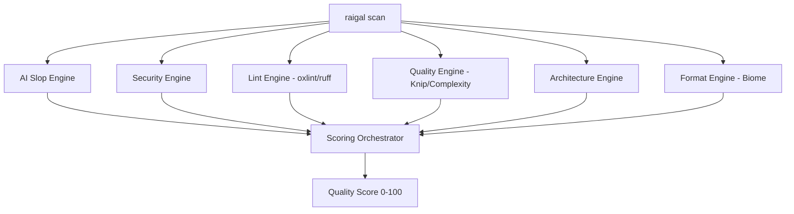

# Rules and engines

Raigal runs six engines in parallel during each scan:



## Built-in pattern rules

| Rule ID | Severity | What it detects | Auto-fixable |
|---|---|---|---|
| `ai-slop/trivial-comment` | Warning | Comments that restate function or variable names | Yes |
| `ai-slop/defensive-null` | Warning | Null checks on values guaranteed not null by types | Yes |
| `ai-slop/fake-polyfill` | Error | Re-implemented helper methods that replace standard library functions | No (Agent) |
| `ai-slop/silent-catch` | Error | Empty catch blocks that discard errors without logging or rethrowing | No (Agent) |
| `ai-slop/any-cast` | Warning | Unsafe `as any` type casts used to bypass the type checker | No (Agent) |
| `ai-slop/over-engineered-regex` | Warning | Complex regular expressions where string methods work | No (Agent) |
| `ai-slop/duplicate-logic` | Warning | Duplicate helper functions across adjacent modules | Yes |
| `ai-slop/unhandled-todo` | Info | Placeholder TODOs or unimplemented stubs | No |

## Rule overrides

In `.raigal/rules.yml`, adjust severity or turn off rules:

```yaml
rules:
  ai-slop/trivial-comment:
    severity: off
  ai-slop/any-cast:
    severity: error
    weight: 2.0
```
