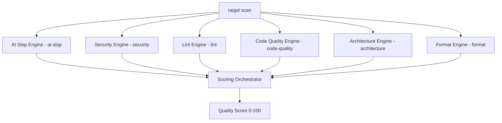

# Rules and engines

Raigal runs six specialized diagnostic engines in parallel during each scan:



## Built-in diagnostic engines

1. **`security`** (Weight: 1.5): detects hardcoded credentials, secret leaks, SQL or shell injections, and vulnerable dependencies.
2. **`ai-slop`** (Weight: 1.0): detects 50+ anti-patterns characteristic of unreviewed AI coding output, such as repetitive narrative comments, redundant null-coalescing, and hallucinated helper functions.
3. **`architecture`** (Weight: 1.0): checks module boundary crossings and circular dependency graphs.
4. **`code-quality`** (Weight: 0.8): checks unused code and exports (via Knip), function complexity, nesting depth, and parameter limits.
5. **`lint`** (Weight: 0.6): runs static analysis across TypeScript, Python, Rust, Go, C#, C++, and Ruby.
6. **`format`** (Weight: 0.3): validates formatting, whitespace, indentation, and import ordering.

## Rule impact tiers

Every rule is classified into an impact tier that determines its deduction multiplier and repository-wide cap:

| Tier | Multiplier | Default cap | Typical finding types |
|---|---|---|---|
| `strict` | $1.0\times$ | Uncapped | Syntax failures, compiler errors, leaked secrets |
| `standard` | $1.0\times$ | Uncapped | Standard linter diagnostics, reliable defect checks |
| `maintainability` | $0.75\times$ | 24 | Cyclomatic complexity, oversized functions |
| `mechanical` | $0.5\times$ | 16 | Dead code, unreferenced local variables |
| `style` | $0.5\times$ | 8 | Formatting variances, naming inconsistencies |
| `advisory` | $0.25\times$ | 8 | Narrative comments, informational notices |

## Common pattern rules

| Rule ID | Severity | What it detects | Auto-fixable |
|---|---|---|---|
| `ai-slop/trivial-comment` | Warning | Comments that restate function or variable names | Yes (`raigal fix`) |
| `ai-slop/defensive-null` | Warning | Null checks on values guaranteed not null by static types | Yes (`raigal fix`) |
| `ai-slop/fake-polyfill` | Error | Helper methods that re-implement standard library utilities | No (Agent) |
| `ai-slop/silent-catch` | Error | Empty catch blocks that discard exceptions without logging | No (Agent) |
| `ai-slop/any-cast` | Warning | Unsafe `as any` type assertions used to bypass type checks | No (Agent) |
| `ai-slop/over-engineered-regex` | Warning | Complex regular expressions where string methods suffice | No (Agent) |
| `ai-slop/duplicate-logic` | Warning | Duplicate helper functions across adjacent modules | Yes (`raigal fix`) |
| `ai-slop/unhandled-todo` | Info | Placeholder TODO comments or unimplemented stubs | No |

## Rule severity overrides

In `.raigal/config.yml`, configure custom severities or disable rules entirely:

```yaml
rules:
  ai-slop/trivial-comment: "off"
  ai-slop/unsafe-type-assertion: "error"
  ai-slop/defensive-null: "warning"
```

Allowed values are `"error"`, `"warning"`, and `"off"`. Setting a rule to `"off"` skips evaluation and eliminates associated score deductions.
