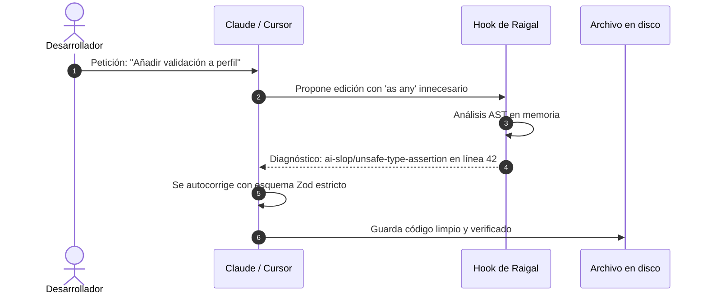

Raigal puede interceptar y revisar los cambios de código propuestos por asistentes de IA antes de que se guarden en disco.

## Cómo funcionan los hooks

Cuando un agente de programación modifica un archivo:
1. El hook ejecuta un análisis AST rápido en memoria sobre los archivos cambiados (`runScopedScan`).
2. Las tareas lentas (auditorías de red, chequeo de tipos con `tsc` o formateadores pesados) se omiten para mantener la respuesta casi instantánea.
3. Si el cambio introduce defectos (como excepciones silenciadas o conversiones `as any`), el hook devuelve el diagnóstico en el turno del propio agente.
4. El asistente lee la respuesta estructurada y se autocorrige en el mismo turno antes de que tú veas el fallo.



## Instalación de hooks

Instala los hooks para todos los asistentes detectados en tu máquina:

```bash
raigal hook install
```

O instala solo para herramientas específicas:

```bash
raigal hook install --claude
raigal hook install --cursor
raigal hook install --gemini
```

Añade `--project` para limitar los hooks exclusivamente al repositorio actual en lugar de aplicarlos a nivel global.

## Estado, líneas base y seguridad

### Comprobar estado e integridad
Revisa los hooks activos y sus firmas de integridad SHA-256:

```bash
raigal hook status
```

### Capturar la línea base (baseline)
Registra la deuda técnica actual antes de activar comprobaciones incrementales:

```bash
raigal hook baseline
```

Esto guarda una instantánea en `.raigal/baseline.json`. Las ediciones posteriores del asistente se comparan contra esta base para evitar falsas alertas por código heredado.

### Desinstalación limpia
Elimina los hooks sin modificar tus configuraciones personalizadas del editor:

```bash
raigal hook uninstall
```

<Info>
  Para conectar las herramientas de Raigal directamente al flujo de llamadas de herramientas del agente en lugar de usar hooks de archivos, consulta el [Servidor MCP](/es/automation-and-ci-cd/mcp-server).
</Info>
