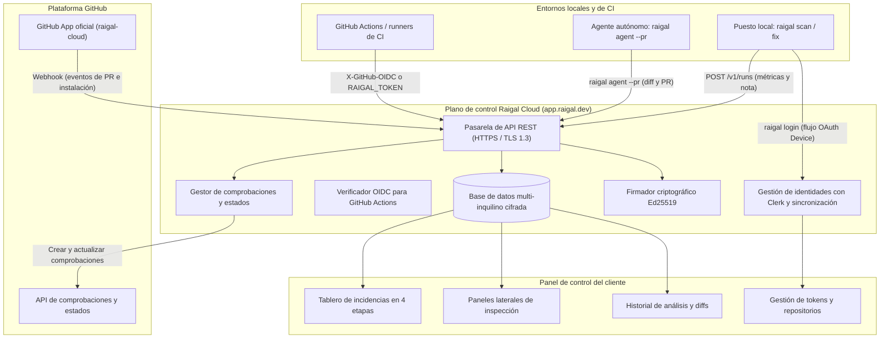

Raigal Cloud (`https://app.raigal.dev`) es la plataforma web y el servicio de control para Raigal. Gestiona las comprobaciones en pull requests, organiza incidencias en tableros, autentica a los usuarios y firma licencias para trabajo sin conexión.

## Topología del sistema

## Privacidad y tratamiento del código fuente

El código fuente completo de tus proyectos nunca se envía, procesa ni almacena en los servidores de Raigal Cloud.

Separación estricta entre análisis y plano de control:
1. **Ejecución 100% en local y en runners**: El análisis de AST, los linters (Oxlint, Ruff, Biome) y las reglas corren exclusivamente en tu máquina o runner de CI.
2. **Informes de diagnóstico**: Al finalizar un análisis, solo se envían datos estadísticos:
   - Puntuación obtenida (0-100) y desglose por categorías
   - Identificadores de reglas infringidas (como `ai-slop/trivial-comment` o `security/eval`)
   - Rutas relativas de archivos y coordenadas de línea
   - Métricas del diff (número de archivos modificados, líneas añadidas y eliminadas)
3. **Vistas previas de diff en pull requests**: Durante las comprobaciones de CI, se envía una vista previa del parche git (limitada a 20 KB) para visualizar las líneas modificadas en el panel web. Antes de transmitirse, este diff se limpia con `maskSecrets`, que elimina tokens Bearer, contraseñas, claves privadas y cabeceras de autorización.

## Integración con la GitHub App

Raigal se conecta con GitHub mediante la app oficial `raigal-cloud`:

- **Comprobaciones automáticas**: Al abrir o actualizar un pull request, GitHub notifica a Raigal Cloud, que crea una comprobación pendiente "Raigal Quality Gate" en el commit correspondiente.
- **Actualización de resultados**: Cuando el runner de CI termina, envía la nota a Raigal Cloud, que aprueba o suspende la comprobación y desbloquea las reglas de protección de ramas.
- **Eventos de ciclo de vida**: Las fusiones y cierres de ramas se reciben por webhooks de GitHub, manteniendo el tablero al día sin scripts de limpieza adicionales.
- **Tiempo límite de seguridad**: Si un trabajo de CI se cancela o interrumpe, Raigal Cloud elimina comprobaciones huérfanas tras 20 minutos para no bloquear pull requests.

## Autenticación y control de accesos

### Aislamiento multi-inquilino
Raigal Cloud aísla los datos de cada organización mediante Clerk. Repositorios, análisis, incidencias y tokens se particionan estrictamente por organización. Las cuentas nuevas disponen de 14 días de prueba con todas las funciones activas.

### OIDC en GitHub Actions
En flujos de CI, los runners se autentican con tokens efímeros:
- El runner solicita un token OIDC a `token.actions.githubusercontent.com`.
- El runner envía el token en la cabecera `X-GitHub-OIDC` a `/v1/runs`.
- Raigal verifica la firma y comprueba que el repositorio pertenece a tu organización.
- Tras la validación, se concede permiso de un solo uso para registrar ese escaneo.

### Inicio de sesión desde la CLI (RFC 8628)
Los desarrolladores inician sesión con `raigal login`. Utiliza el flujo OAuth 2.0 Device Authorization (RFC 8628), abriendo el navegador para autorizar la sesión.

### Funcionamiento sin conexión y entornos aislados (air-gap)
Raigal soporta dos modos de trabajo desconectado:
- **Licencias temporales de 72 horas**: Para desarrollo local y viajes, la CLI guarda una licencia firmada con Ed25519 válida durante 72 horas. Se verifica en local con la clave pública del binario.
- **Licencias estáticas para entornos aislados**: Para redes privadas sin salida a internet o runners en VPCs restringidas, Raigal ofrece tokens de licencia estáticos (válidos de 1 a 3 años) sin llamadas a servidores externos, así como la opción de autohospedar el plano de control.

## Gestión de repositorios

Los administradores configuran sus proyectos desde **Settings** > **Repositories**:
- Consulta todos los repositorios sincronizados y sus ramas activas.
- Modifica los umbrales de calidad por proyecto.
- Genera o revoca tokens de acceso para CI.
