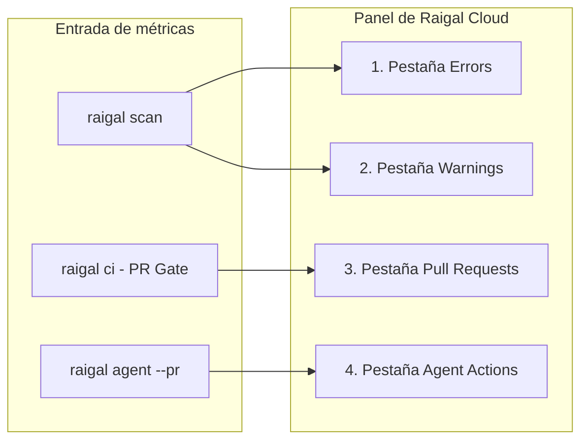

Raigal Cloud (`https://app.raigal.dev`) unifica los datos de escaneo de tus análisis locales, flujos de CI y webhooks de GitHub en una interfaz clara de seguimiento.

## Estructura del panel

La interfaz organiza la información del repositorio en cinco áreas principales:

### 1. Cabecera del repositorio

La barra superior muestra el estado en tiempo real del proyecto seleccionado:
- **Selector de repositorio**: Cambia de repositorio o busca por nombre.
- **Selector de ramas**: Alterna entre ramas (`main`, `develop`, ramas de tareas) para ver incidencias específicas.
- **Nota de salud**: Muestra la nota actual de 0 a 100 con el color de su banda. Raigal utiliza exclusivamente notas numéricas sin calificaciones por letras.
- **Hora del último análisis**: Muestra cuándo se ejecutó el último escaneo.
- **Total de incidencias**: Número de problemas activos en la rama seleccionada.
- **Botón de recarga**: Actualiza los datos con el análisis más reciente.

<Info>
  Los escaneos enviados a tu rama principal (`main` o `develop`) fijan la línea base del repositorio en las pestañas **Errors** y **Warnings**. Los escaneos de pull requests se guardan en la pestaña **Pull Requests**.
</Info>

### 2. Barra lateral y acciones rápidas

La barra lateral izquierda facilita la navegación:
- **Navegación principal**: Accesos directos a Overview, Activity, Settings y Documentación.
- **Acciones rápidas (`Cmd + K` o `Ctrl + K`)**: Abre la paleta de comandos para buscar proyectos, cambiar de rama o copiar comandos de la CLI.
- **Infracciones más frecuentes**: Lista las seis reglas con mayor número de avisos activos con su gravedad y recuento. Al pulsar sobre una regla, la vista filtra las tarjetas al instante.

### 3. Fases de incidencias

El panel central divide las incidencias en cuatro pestañas:

#### Errors
- Incidencias graves: vulnerabilidades de seguridad (`security/hardcoded-secret`, `security/eval`), excepciones silenciadas (`ai-slop/swallowed-exception`) y fallos estrictos de compilador o linter.
- Detalles: archivo, línea, descripción de la regla y etiqueta de gravedad.
- Acciones: al pulsar en una tarjeta se abre el panel lateral con consejos de solución o el comando para corregirlo.

#### Warnings
- Avisos no bloqueantes: problemas de estilo (`ai-slop/trivial-comment`), duplicación de código (`code-quality/duplicate-block`), tareas pendientes (`ai-slop/todo-stub`) y avisos de mantenibilidad (`ai-slop/unsafe-type-assertion`).
- Acciones: copia directa del comando de corrección automática (`npx @methiu/raigal fix`).

#### Pull Requests
- Revisiones de cambios evaluadas por `raigal ci` o por la GitHub App.
- Estados de control de calidad:
  - `Passed [nota]`: cumple el umbral con 0 errores y 0 advertencias.
  - `Passed (With Warnings) [nota]`: cumple el umbral sin errores bloqueantes, aunque hay advertencias informativas.
  - `Failed [nota]`: la nota queda por debajo del mínimo o contiene errores bloqueantes.
  - `Pending`: análisis en curso o a la espera del runner de CI.
- Filtros: filtra la lista según si están aprobadas o bloqueadas (`Passed` o `Failed`).

#### Agent Actions
- Pull requests generados automáticamente durante sesiones de reparación con agentes (`raigal agent --pr`).
- Información resumida:
  - Proveedor del agente: identifica la herramienta utilizada (`claude`, `codex`, `opencode`).
  - Ganancia de puntos: muestra la mejora conseguida (por ejemplo: `71 -> 89 (+18 pts)`).
  - Parche del diff: muestra el diff unificado probado en el worktree aislado.

### 4. Filtros facetados

Junto al listado de tarjetas, la barra de filtros permite acotar listas largas:
- **Por motor**: Filtra incidencias según el motor (`security`, `ai-slop`, `lint`, `code-quality`, `format`, `architecture`).
- **Por carpeta**: Limita las incidencias a directorios concretos (como `src/api` o `packages/core`).
- **Por estado de PR**: Filtra pull requests según si están aprobados o fallidos (`Passed` o `Failed`).

### 5. Paneles laterales de inspección

Al pulsar sobre una tarjeta se despliega un panel lateral con información detallada:

<table>
  <thead>
    <tr>
      <th>Panel</th>
      <th>Contenido</th>
      <th>Acción rápida</th>
    </tr>
  </thead>
  <tbody>
    <tr>
      <td><strong>Panel de vulnerabilidad</strong></td>
      <td>Regla, motor, archivo, línea, fragmento de código y guía de solución.</td>
      <td><code>Copiar corrección CLI</code>: copia el comando de arreglo automático al portapapeles.</td>
    </tr>
    <tr>
      <td><strong>Panel de pull request</strong></td>
      <td>Nombre de la rama, autor, cambio de puntuación, logs de CI e incidencias bloqueantes.</td>
      <td><code>Copiar git checkout</code>: copia el comando para cambiar a esa rama en local.</td>
    </tr>
    <tr>
      <td><strong>Panel de agente</strong></td>
      <td>Herramienta utilizada, turnos empleados, progresión de la nota y diff unificado.</td>
      <td><code>Copiar gh merge</code>: copia el comando para fusionar el PR del agente con GitHub CLI.</td>
    </tr>
  </tbody>
</table>

## Bandas de puntuación de salud

El panel clasifica las notas en cuatro bandas de salud:

| Rango de nota | Banda | Indicador | Estado en control de calidad |
|---|---|---|---|
| 90 - 100 | `Excellent` | Verde lima | Aprobado |
| 75 - 89 | `Good` | Verde esmeralda | Aprobado (cumple el umbral estándar de 75) |
| 50 - 74 | `Needs Work` | Ámbar / amarillo | No alcanza el umbral estándar |
| < 50 | `Critical` | Rojo | Suspenso |

En la salida de consola, la CLI simplifica estos rangos en tres estados: `Healthy` (75 o más), `Needs Work` (50 a 74) y `Critical` (menos de 50). Nunca se emplean letras (A-E).

## Ajustes de la organización

En **Settings** (`app.raigal.dev/settings`), los administradores pueden gestionar el equipo:
- **Repositories**: Consulta los repositorios conectados, ajusta permisos o desconecta proyectos.
- **API tokens**: Genera o revoca claves de API para la organización (`rgl_live_...`).
- **Members and roles**: Gestiona invitaciones de miembros y acceso SSO.
