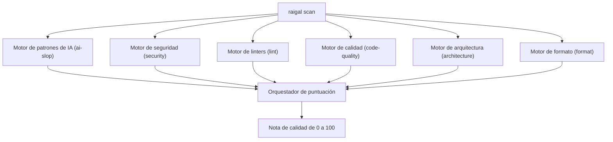

Raigal ejecuta seis motores de análisis especializados en paralelo durante cada escaneo:



## Motores de análisis integrados

1. **`security`** (Peso: 1.5): busca credenciales expuestas, fugas de secretos, inyección en prompts de LLMs, herramientas de agentes sin aislamiento en sandbox, inyecciones SQL/shell y dependencias con vulnerabilidades conocidas.
2. **`ai-slop`** (Peso: 1.0): incluye más de 50 reglas en 6 lenguajes (TypeScript/JavaScript, Python, Go, Rust, C#, C++), detectando excepciones silenciadas, comentarios obvios, aserciones de tipo laxas y stubs vacíos.
3. **`architecture`** (Peso: 1.0): valida los límites entre módulos y detecta dependencias circulares.
4. **`code-quality`** (Peso: 0.8): encuentra código y exportaciones sin uso (mediante Knip), funciones demasiado complejas, anidamiento excesivo y firmas con demasiados parámetros.
5. **`lint`** (Peso: 0.6): ejecuta análisis estático rápido con Oxlint (JS/TS), Ruff (Python), Clippy (Rust), herramientas de Go, Roslynator (C#), Clang-Tidy (C++) y RuboCop.
6. **`format`** (Peso: 0.3): revisa formato, sangría, espacios y orden de importaciones.

## Niveles de impacto de las reglas

Cada regla se asigna a un nivel de impacto que define su multiplicador de penalización y su tope dentro del repositorio:

| Nivel | Multiplicador | Tope por defecto | Tipos de incidencias habituales |
|---|---|---|---|
| `strict` | `1.0x` | Sin tope (`maxPerRule`) | Secretos filtrados, inyecciones de prompt, excepciones silenciadas |
| `standard` | `1.0x` | Sin tope (`maxPerRule`) | Avisos de linters y advertencias de compilador |
| `maintainability` | `0.75x` | 24 | Funciones excesivamente largas, complejidad alta |
| `mechanical` | `0.5x` | 16 | Importaciones huérfanas, variables locales sin referencia |
| `style` | `0.5x` | 8 | Discrepancias de formato, comentarios innecesarios |
| `advisory` | `0.25x` | 8 | Auditorías omitidas y avisos informativos |

## Reglas más habituales

| Identificador de regla | Motor | Severidad | Qué detecta | Corrección automática |
|---|---|---|---|---|
| `ai-slop/swallowed-exception` | `ai-slop` | Warning | Bloque catch que silencia un error sin gestionarlo ni relanzarlo | No (Agente) |
| `ai-slop/trivial-comment` | `ai-slop` | Warning | Comentarios que solo repiten declaraciones obvias de funciones | Sí (`raigal fix`) |
| `ai-slop/narrative-comment` | `ai-slop` | Warning | Párrafos de comentarios que narran el razonamiento interno de la IA | Sí (`raigal fix`) |
| `ai-slop/unsafe-type-assertion` | `ai-slop` | Warning | Conversiones inseguras (`as any`, `as unknown as T`) que anulan el tipado | No (Agente) |
| `ai-slop/constant-condition` | `ai-slop` | Warning | Expresiones condicionales que siempre devuelven true o false | No (Agente) |
| `ai-slop/todo-stub` | `ai-slop` | Warning | Marcadores TODO, FIXME o stubs que dejan lógica sin implementar | No (Agente) |
| `ai-slop/thin-wrapper` | `ai-slop` | Warning | Funciones que solo reenvían argumentos sin aportar lógica | No (Agente) |
| `ai-slop/unused-import` | `ai-slop` | Warning | Símbolos o módulos importados que nunca se utilizan | Sí (`raigal fix`) |
| `security/prompt-injection` | `security` | Error | Inserción directa de variables sin sanitizar en prompts del sistema | No (Agente) |
| `security/unsandboxed-agent-tool` | `security` | Error | Herramientas de agente que ejecutan comandos sin aislamiento | No (Agente) |
| `security/hardcoded-secret` | `security` | Error | Claves de API, contraseñas o certificados incrustados en código | No |
| `security/eval` | `security` | Error | Ejecución dinámica de código (`eval`, `new Function`) | No |
| `code-quality/duplicate-block` | `code-quality` | Warning | Bloques de código duplicados entre módulos | No (Agente) |

## Configurar severidades y excepciones

En `.raigal/config.yml` puedes personalizar la gravedad de cada regla o desactivarla:

```yaml
rules:
  ai-slop/trivial-comment: "off"
  ai-slop/unsafe-type-assertion: "error"
  ai-slop/constant-condition: "warning"
```

Los valores admitidos son `"error"`, `"warning"` y `"off"`. Desactivar una regla (`"off"`) desactiva su comprobación y evita que reste puntos.
