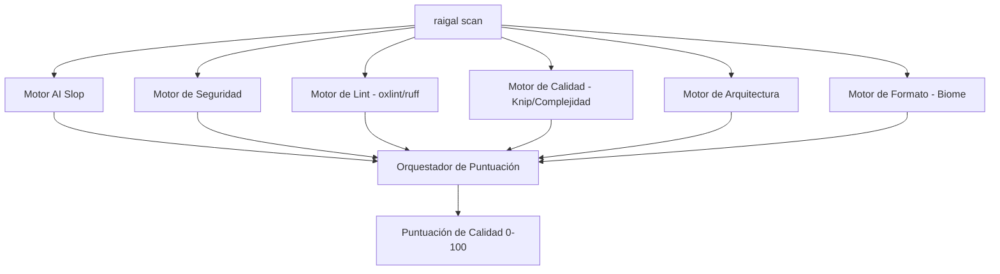

# Reglas y motores de análisis

Raigal ejecuta seis motores en paralelo durante cada análisis:



## Reglas integradas de patrones

| Identificador | Severidad | Qué detecta | Corrección automática |
|---|---|---|---|
| `ai-slop/trivial-comment` | Warning | Comentarios que solo repiten nombres de funciones o variables | Sí |
| `ai-slop/defensive-null` | Warning | Comprobaciones de nulos en tipos ya garantizados | Sí |
| `ai-slop/fake-polyfill` | Error | Métodos auxiliares redundantes que reinventan la librería estándar | No (Agente) |
| `ai-slop/silent-catch` | Error | Bloques `catch` vacíos que descartan errores sin registrar ni relanzar | No (Agente) |
| `ai-slop/any-cast` | Warning | Casts de tipo `as any` para ignorar el comprobador estático | No (Agente) |
| `ai-slop/over-engineered-regex` | Warning | Expresiones regulares complejas donde bastan métodos de cadena | No (Agente) |
| `ai-slop/duplicate-logic` | Warning | Funciones auxiliares duplicadas entre módulos cercanos | Sí |
| `ai-slop/unhandled-todo` | Info | Comentarios TODO o stubs vacíos sin implementar | No |

## Ajustes de reglas

En el archivo `.raigal/rules.yml` puede cambiar la severidad o desactivar reglas:

```yaml
rules:
  ai-slop/trivial-comment:
    severity: off
  ai-slop/any-cast:
    severity: error
    weight: 2.0
```
