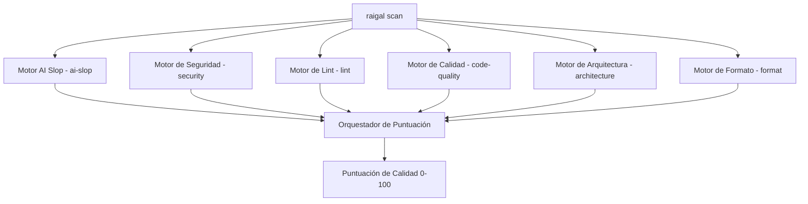

# Reglas y motores de análisis

Raigal ejecuta seis motores de diagnóstico especializados en paralelo durante cada análisis:



## Motores de diagnóstico integrados

1. **`security`** (Peso: 1.5): detecta credenciales expuestas en código, fugas de secretos, inyecciones SQL o de shell y dependencias vulnerables.
2. **`ai-slop`** (Peso: 1.0): analiza más de 50 antipatrones habituales en código generado por IA sin revisar, como comentarios narrativos repetitivos, comprobaciones nulas superfluas y funciones auxiliares redundantes.
3. **`architecture`** (Peso: 1.0): valida límites entre módulos y detecta grafos de dependencias circulares.
4. **`code-quality`** (Peso: 0.8): localiza código y exportaciones sin uso (mediante Knip), complejidad ciclomática excesiva, anidamiento profundo y límites de parámetros.
5. **`lint`** (Peso: 0.6): ejecuta análisis estático multilingüe en TypeScript, Python, Rust, Go, C#, C++ y Ruby.
6. **`format`** (Peso: 0.3): revisa formato, sangrado, espacios en blanco y orden de importaciones.

## Niveles de impacto de las reglas

Cada regla se clasifica en un nivel de impacto que define su multiplicador de deducción y su tope máximo en el repositorio:

| Nivel | Multiplicador | Tope por defecto | Tipos de hallazgos habituales |
|---|---|---|---|
| `strict` | $1.0\times$ | Sin tope | Errores de sintaxis, fallos de compilador, secretos filtrados |
| `standard` | $1.0\times$ | Sin tope | Diagnósticos estándar de linters y detección fiable de defectos |
| `maintainability` | $0.75\times$ | 24 | Complejidad ciclomática alta y funciones excesivamente largas |
| `mechanical` | $0.5\times$ | 16 | Código muerto y variables locales no referenciadas |
| `style` | $0.5\times$ | 8 | Variaciones de formato y discrepancias de nombres |
| `advisory` | $0.25\times$ | 8 | Comentarios redundantes y avisos informativos |

## Reglas de patrones habituales

| Identificador | Severidad | Qué detecta | Corrección automática |
|---|---|---|---|
| `ai-slop/trivial-comment` | Warning | Comentarios que solo repiten nombres de funciones o variables | Sí (`raigal fix`) |
| `ai-slop/defensive-null` | Warning | Comprobaciones de nulos en tipos garantizados por el compilador | Sí (`raigal fix`) |
| `ai-slop/fake-polyfill` | Error | Métodos auxiliares que reimplementan funciones de la librería estándar | No (Agente) |
| `ai-slop/silent-catch` | Error | Bloques `catch` vacíos que descartan excepciones sin registrar | No (Agente) |
| `ai-slop/any-cast` | Warning | Aserciones de tipo `as any` utilizadas para saltarse comprobaciones | No (Agente) |
| `ai-slop/over-engineered-regex` | Warning | Expresiones regulares complejas donde bastan métodos de cadena | No (Agente) |
| `ai-slop/duplicate-logic` | Warning | Funciones auxiliares duplicadas entre módulos contiguos | Sí (`raigal fix`) |
| `ai-slop/unhandled-todo` | Info | Comentarios TODO pendientes o stubs vacíos | No |

## Ajustes de severidad de reglas

En `.raigal/config.yml` puede configurar severidades personalizadas o desactivar reglas por completo:

```yaml
rules:
  ai-slop/trivial-comment: "off"
  ai-slop/unsafe-type-assertion: "error"
  ai-slop/defensive-null: "warning"
```

Los valores admitidos son `"error"`, `"warning"` y `"off"`. Desactivar una regla (`"off"`) suprime su análisis y elimina cualquier deducción asociada de la puntuación.
