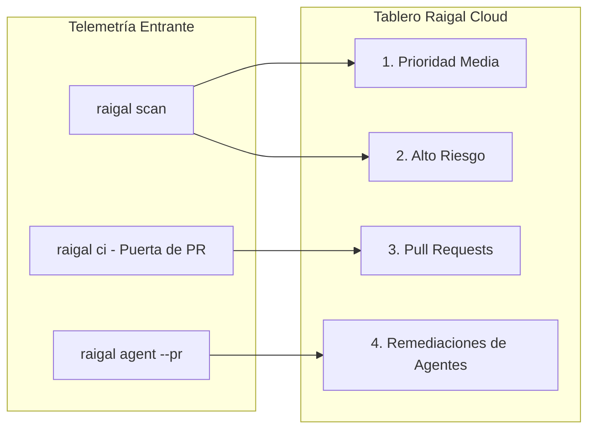

# Tablero Kanban de Remediación y Telemetría

Raigal Cloud (`https://app.raigal.dev`) proporciona un tablero Kanban interactivo y ponderado por densidad que transforma la telemetría de calidad de código en flujos de trabajo priorizados para desarrolladores.

---

## El Tablero Kanban en 4 Etapas

El tablero de remediación organiza los hallazgos de sus repositorios en cuatro columnas especializadas:

### 1. Prioridad Media
- **Enfoque:** Advertencias no bloqueantes, aspectos de estilo, código muerto secundario y patrones leves de AI slop (comentarios triviales, comprobaciones nulas redundantes).
- **Acciones:** Copia directa en un clic del comando de autocorrección (`npx @methiu/raigal fix --rule <rule-id>`).
- **Inspección:** Al hacer clic en cualquier tarjeta se abre el panel lateral de inspección con fragmentos de código y números de línea.

### 2. Alto Riesgo
- **Enfoque:** Bloqueadores críticos que detienen las puertas de CI, secretos de API expuestos, inyecciones SQL/comandos, conversiones inseguras (`as any`) y controladores de excepción vacíos (`silent-catch`).
- **Acciones:** Indicadores críticos destacados con recomendaciones de corrección determinista.

### 3. Pull Requests (Puertas de CI)
- **Enfoque:** Pull Requests activos evaluados por la puerta de calidad de Raigal mediante GitHub Actions o webhooks de la GitHub App.
- **Insignias de Estado:**
  - `APROBADO [puntuación]`: El PR cumple o supera el umbral de calidad configurado.
  - `BLOQUEADO [puntuación]`: El PR contiene infracciones bloqueantes o no alcanza la puntuación mínima.
  - `EN REVISIÓN / PENDIENTE`: El PR está abierto y a la espera de la evaluación de CI (creado instantáneamente por la GitHub App).
  - `FUSIONADO`: El PR ha sido integrado en la rama base (actualizado automáticamente por el webhook de la GitHub App).
  - `CERRADO`: El PR se cerró sin fusionar.
- **Idempotencia y Aislamiento:** Los envíos sucesivos de commits en el mismo PR actualizan la tarjeta existente sin duplicarla. Se previene la sobreescritura por entregas de webhooks fuera de orden.

### 4. Remediaciones de Agentes (`--pr`)
- **Enfoque:** Pull Requests generados de manera autónoma por agentes de programación de IA (`raigal agent --provider <opencode|claude|codex> --pr`).
- **Telemetría:**
  - **Insignia del Proveedor:** Identifica al agente autor (`opencode`, `claude`, `codex`, u orquestadores a medida).
  - **Mejora de Puntuación:** Refleja la variación medida antes y después (p. ej., `72 → 88 (+16 pts)`).
  - **Parche de Diferencias:** Muestra el diff unificado exacto generado y verificado en worktrees aislados.

---

## Paneles Laterales de Inspección Contextual

Cada tarjeta del tablero puede desplegar un panel lateral interactivo con información en profundidad:

<table data-view="cards">
  <thead>
    <tr>
      <th>Panel</th>
      <th>Contenido</th>
      <th>Acción Principal</th>
    </tr>
  </thead>
  <tbody>
    <tr>
      <td><strong>Panel de Vulnerabilidades</strong></td>
      <td>ID de regla, motor, línea, ruta de archivo y explicación técnica.</td>
      <td><code>Copiar Fix CLI</code> — Copia el comando exacto al portapapeles.</td>
    </tr>
    <tr>
      <td><strong>Panel de Pull Request</strong></td>
      <td>Rama, autor, puntuación, registros de la puerta de CI y hallazgos bloqueantes.</td>
      <td><code>Copiar git checkout</code> — Copia el comando para revisar la rama.</td>
    </tr>
    <tr>
      <td><strong>Panel de Agente Autónomo</strong></td>
      <td>Proveedor del agente, comparación de puntuaciones y diff del parche.</td>
      <td><code>Copiar gh merge</code> — Copia el comando de fusión en GitHub.</td>
    </tr>
  </tbody>
</table>

---

## Gobernanza y Gestión de Repositorios

Desde el panel de **Configuración** (`https://app.raigal.dev/settings`), los administradores gestionan el acceso del equipo y el ciclo de vida de los proyectos:

### 1. Selector de Repositorios Activos y Filtro de Ramas
- Utilice el selector del encabezado para cambiar entre los repositorios monitoreados.
- Use el menú desplegable de ramas para cambiar de rama (`main`, `develop`, ramas de características). El tablero reajusta inmediatamente las métricas a la rama seleccionada.
- Los enlaces directos preservan el estado del espacio de trabajo: `/repos/:repoId?branch=feat/auth&drawer=vuln&id=...`.

### 2. Eliminación de Repositorios en Desuso
Si un repositorio es retirado, renombrado o deja de estar monitorizado:
1. Diríjase a **Configuración** > **Repositorios**.
2. Localice el repositorio en la lista.
3. Haga clic en el botón **Eliminar** (icono de papelera).
4. Confirme la solicitud de eliminación.


Eliminar un repositorio purga de forma irreversible todas las ejecuciones de escaneo históricas, puntuaciones de calidad, evaluaciones de Pull Requests y tarjetas de hallazgos asociadas.


### 3. Gobernanza de Tokens de API
- Genere claves granulares para diferentes entornos de CI o equipos de desarrollo.
- Revoque claves comprometidas o desactualizadas con un solo clic.

---

## Navegación Rápida y Paleta de Comandos (`⌘ K`)

Raigal Cloud incluye una paleta de comandos global para acceder rápidamente a cualquier función:
- Presione `⌘ K` (o `Ctrl K` en Windows/Linux) en cualquier lugar del panel.
- Busque rápidamente entre repositorios y ramas.
- Acceda directamente a guías de documentación.
- Copie comandos de escaneo y corrección del CLI.
- Solicite la sincronización manual de repositorios de GitHub.
