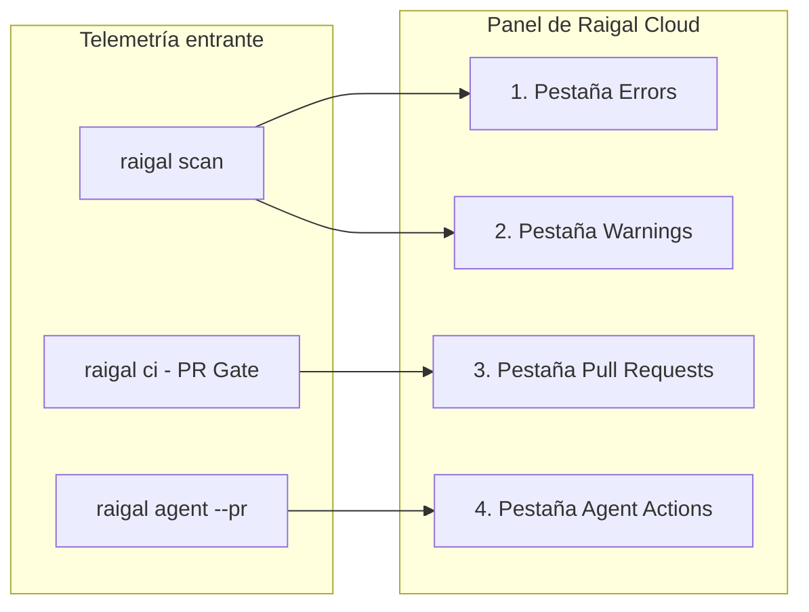

# Panel de remediación y telemetría

Raigal Cloud (`app.raigal.dev`) unifica los datos de escaneo procedentes de ejecuciones locales, pipelines de CI y webhooks de la GitHub App en una interfaz centralizada de remediación.

## Estructura del panel

La interfaz organiza el estado del repositorio en cinco áreas principales:

### 1. Cabecera del repositorio

La barra superior muestra el contexto en tiempo real del proyecto seleccionado:
- Selector de repositorio: permite alternar entre repositorios autorizados o filtrar por nombre.
- Selector de ramas: cambia entre ramas (`main`, `develop`, ramas de funcionalidad) para inspeccionar incidencias específicas.
- Insignia de puntuación de salud: muestra la puntuación numérica actual de 0 a 100 con un indicador de color según la banda. Raigal emplea estrictamente valores numéricos sin calificaciones por letras.
- Marca temporal relativa: indica cuándo finalizó el último análisis.
- Recuento de hallazgos: número total de incidencias activas en la rama seleccionada.
- Botón de actualización: solicita los datos más recientes de escaneo.

### 2. Barra lateral y acciones rápidas

La barra lateral izquierda gestiona la navegación del espacio de trabajo:
- Navegación principal: accesos directos a Overview, Activity, Settings y Docs.
- Acciones rápidas (`Cmd + K` o `Ctrl + K`): abre la paleta de comandos para buscar repositorios, cambiar de rama o copiar comandos del CLI.
- Faceta de infracciones frecuentes: enumera las seis reglas con mayor número de avisos activos junto con su severidad y recuento. Al pulsar sobre una regla, la vista filtra las tarjetas inmediatamente.

### 3. Etapas de hallazgos

El panel central divide las incidencias en cuatro pestañas especializadas:

#### Errors
- Incidencias de alta severidad: vulnerabilidades de seguridad (`security/hardcoded-secret`, `security/eval`), excepciones silenciadas (`ai-slop/swallowed-exception`) y fallos estrictos de compilador o linter.
- Detalles: rutas relativas, coordenadas de línea, descripción de la regla e insignias de severidad.
- Acciones: selección de tarjeta para abrir el panel de vulnerabilidad o copiar comandos de corrección.

#### Warnings
- Avisos no bloqueantes: problemas de estilo (`ai-slop/trivial-comment`), duplicación de código (`code-quality/duplicate-block`), stubs incompletos (`ai-slop/todo-stub`) y advertencias de mantenibilidad (`ai-slop/unsafe-type-assertion`).
- Acciones: copia directa del comando de corrección por regla (`npx @methiu/raigal fix --rule <rule-id>`).

#### Pull Requests
- Solicitudes de cambios evaluadas por `raigal ci` o por la GitHub App.
- Insignias de estado:
  - `Passed [puntuación]`: la puntuación cumple `ci.failBelow` y no contiene errores bloqueantes.
  - `Failed [puntuación]`: la puntuación queda por debajo del umbral o contiene errores bloqueantes.
  - `Pending`: análisis en curso o a la espera del runner de CI.
- Filtros: filtrado inmediato por resultado del control de calidad (`Passed` o `Failed`).

#### Agent Actions
- Pull requests generados durante sesiones de reparación autónoma con agentes.
- Detalles del resumen:
  - Insignia del proveedor: identifica el agente utilizado (`claude`, `codex`, `opencode`).
  - Diferencia de puntuación: muestra la mejora conseguida (por ejemplo, `71 -> 89 (+18 pts)`).
  - Diff del parche: muestra el diff unificado verificado en el worktree aislado.

### 4. Filtros facetados

Situada junto al listado de tarjetas, la barra de filtros permite acotar grandes volúmenes de incidencias:
- Faceta de motor: filtra incidencias según el motor de diagnóstico (`security`, `ai-slop`, `lint`, `code-quality`, `format`, `architecture`).
- Faceta de carpeta: aísla las incidencias a subdirectorios concretos (como `src/api` o `packages/core`).
- Faceta de control de calidad: filtra registros de pull requests según su resultado (`Passed` o `Failed`).

### 5. Paneles deslizantes de inspección

Al pulsar sobre una tarjeta se despliega un panel lateral con información detallada:

<table data-view="cards">
  <thead>
    <tr>
      <th>Panel</th>
      <th>Contenido</th>
      <th>Acción principal</th>
    </tr>
  </thead>
  <tbody>
    <tr>
      <td><strong>Panel de vulnerabilidad</strong></td>
      <td>Identificador de regla, motor, ruta de archivo, línea, fragmento de código y guía de remediación.</td>
      <td><code>Copy CLI Fix</code>: copia el comando de corrección determinista al portapapeles.</td>
    </tr>
    <tr>
      <td><strong>Panel de pull request</strong></td>
      <td>Nombre de rama, autor, variación de puntuación, registros de CI e incidencias bloqueantes.</td>
      <td><code>Copy git checkout</code>: copia el comando para clonar o cambiar a la rama.</td>
    </tr>
    <tr>
      <td><strong>Panel de agente</strong></td>
      <td>Proveedor del agente, turnos empleados, progresión de puntuación y parche unificado completo.</td>
      <td><code>Copy gh merge</code>: copia el comando de GitHub CLI para fusionar la PR del agente.</td>
    </tr>
  </tbody>
</table>

## Rangos de salud de la puntuación

El panel clasifica las puntuaciones en cuatro bandas de salud calibradas:

| Rango de puntuación | Banda en panel web | Color identificativo | Estado del control de calidad |
|---|---|---|---|
| 90 - 100 | `Excellent` | Verde lima | Aprobado |
| 75 - 89 | `Good` | Verde esmeralda | Aprobado (supera el umbral por defecto de 75) |
| 50 - 74 | `Needs Work` | Ámbar / amarillo | Requiere atención (no alcanza el umbral) |
| < 50 | `Critical` | Rojo | Falla el control de calidad |

En la salida de la terminal, el CLI simplifica estos rangos en tres estados operativos: `Healthy` (75 o superior), `Needs Work` (50 a 74) y `Critical` (inferior a 50). No se utilizan letras (A-E).

## Configuración de la organización

En **Settings** (`app.raigal.dev/settings`), los administradores gestionan el acceso:
- **Repositorios**: consulta repositorios sincronizados, configura permisos de la GitHub App o elimina proyectos que ya no se monitorizan.
- **Tokens de API**: genera o revoca claves de organización (`rgl_live_...`).
- **Miembros y funciones**: administra accesos de equipo y autenticación corporativa (SSO).
