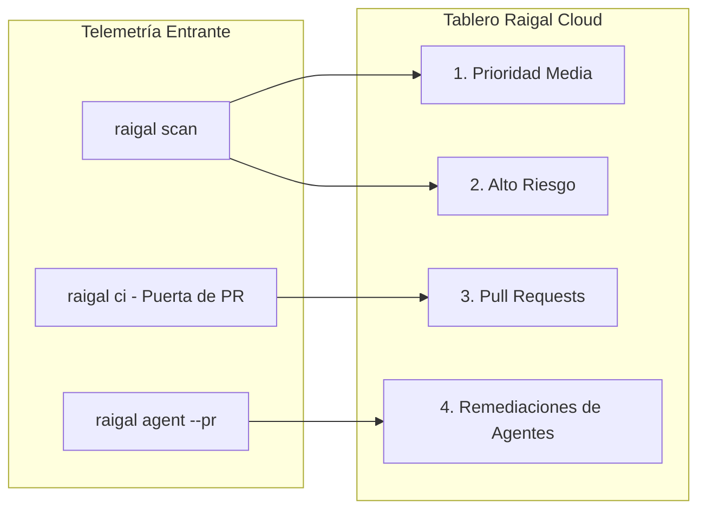

# Tablero de remediación y telemetría

Raigal Cloud (`https://app.raigal.dev`) organiza los resultados de los análisis y las incidencias pendientes en un tablero de cuatro columnas.

## Las cuatro columnas del tablero

El tablero agrupa los hallazgos en cuatro columnas:

### 1. Prioridad media
- Contenido: avisos no bloqueantes, estilo, código muerto secundario y patrones leves de IA (comentarios triviales, comprobaciones nulas redundantes).
- Acciones: copia del comando de corrección automática (`npx @methiu/raigal fix --rule <rule-id>`).
- Detalles: al pulsar una tarjeta se abre el panel lateral con fragmentos de código y números de línea.

### 2. Alto riesgo
- Contenido: bloqueadores que detienen CI, credenciales expuestas, inyecciones SQL o de comandos, casts inseguros (`as any`) y bloques catch vacíos (`silent-catch`).
- Acciones: consulta de la documentación de la regla y recomendaciones de solución.

### 3. Pull requests (puertas de CI)
- Contenido: pull requests abiertos evaluados por Raigal en CI o mediante webhooks de la GitHub App.
- Estados:
  - `APROBADO [puntuación]`: cumple o supera el umbral configurado.
  - `BLOQUEADO [puntuación]`: contiene infracciones bloqueantes o no alcanza la puntuación mínima.
  - `EN REVISIÓN / PENDIENTE`: a la espera de evaluación en CI.
  - `FUSIONADO`: integrado en la rama base.
  - `CERRADO`: cerrado sin fusionar.
- Actualización: los commits sucesivos en un mismo PR actualizan la tarjeta correspondiente.

### 4. Remediaciones de agentes (`--pr`)
- Contenido: pull requests generados por agentes de programación (`raigal agent --provider <opencode|claude|codex> --pr`).
- Información:
  - Proveedor: indica la herramienta utilizada (`opencode`, `claude`, `codex`).
  - Variación de puntuación: muestra la puntuación antes y después (ej: `72 -> 88 (+16 pts)`).
  - Diff del parche: muestra las modificaciones generadas en el worktree.

## Paneles laterales de inspección

Al pulsar cualquier tarjeta se despliega un panel lateral con información detallada:

<table data-view="cards">
  <thead>
    <tr>
      <th>Panel</th>
      <th>Contenido</th>
      <th>Acción</th>
    </tr>
  </thead>
  <tbody>
    <tr>
      <td><strong>Panel de vulnerabilidades</strong></td>
      <td>ID de regla, motor, línea, ruta de archivo y explicación.</td>
      <td><code>Copiar Fix CLI</code>: copia el comando de corrección.</td>
    </tr>
    <tr>
      <td><strong>Panel de pull requests</strong></td>
      <td>Rama, autor, puntuación, registros de CI y hallazgos bloqueantes.</td>
      <td><code>Copiar git checkout</code>: copia el comando para cambiar de rama.</td>
    </tr>
    <tr>
      <td><strong>Panel de agentes</strong></td>
      <td>Proveedor, comparativa de puntuación y diff del parche.</td>
      <td><code>Copiar gh merge</code>: copia el comando de fusión de GitHub CLI.</td>
    </tr>
  </tbody>
</table>

## Gestión de repositorios

En **Configuración** (`https://app.raigal.dev/settings`), los administradores gestionan repositorios y credenciales:

### Selector de repositorios y filtro de ramas
- Utilice el selector superior para cambiar de repositorio.
- Seleccione la rama en el menú desplegable (`main`, `develop`, ramas de trabajo).
- El estado seleccionado se mantiene en los enlaces directos: `/repos/:repoId?branch=feat/auth&drawer=vuln&id=...`.

### Eliminar repositorios
Para desvincular un repositorio que ya no se utiliza:
1. Abra **Configuración** > **Repositorios**.
2. Localice el repositorio en la lista.
3. Pulse **Eliminar**.
4. Confirme la acción.


Al eliminar un repositorio se borran de forma permanente sus escaneos históricos, puntuaciones, evaluaciones de pull requests y tarjetas asociadas.


### Tokens de API
- Cree claves para diferentes entornos de CI o equipos.
- Revoque tokens que hayan quedado obsoletos.

## Paleta de comandos (`⌘ K`)

Raigal Cloud incluye una paleta de búsqueda rápida:
- Pulse `⌘ K` (o `Ctrl K` en Windows/Linux).
- Busque repositorios y ramas.
- Acceda a las páginas de documentación.
- Copie comandos de escaneo y corrección del CLI.
- Solicite la sincronización manual con GitHub.
