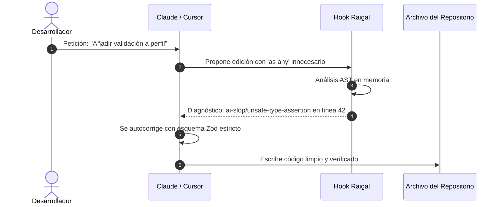

# Hooks de intercepción para agentes

Raigal puede analizar los cambios propuestos por asistentes y agentes de programación antes de que se consoliden en disco.

## Funcionamiento de los hooks

Cuando un agente modifica un archivo:
1. El hook ejecuta un análisis AST acotado sobre los archivos modificados mediante `runScopedScan`.
2. Las tareas pesadas (auditorías de red, chequeo de tipos con `tsc` y formateadores) se desactivan para mantener baja la latencia del turno.
3. Si la edición introduce infracciones de patrones (como excepciones silenciadas o aserciones de tipo inseguras), el hook devuelve información estructurada en el turno del agente.
4. El agente lee el diagnóstico e intenta autocorregirse en el mismo turno.



## Instalación de hooks

Instale los hooks para todas las herramientas detectadas en el sistema:

```bash
raigal hook install
```

O configure herramientas específicas:

```bash
raigal hook install --claude
raigal hook install --cursor
raigal hook install --gemini
```

Añada `--project` para limitar los hooks únicamente al repositorio actual en lugar de la configuración global de usuario.

## Estado, línea base y seguridad

### Estado e integridad de centinelas
Compruebe los hooks activos y sus hashes SHA-256 de integridad:

```bash
raigal hook status
```

### Captura de líneas base (Baseline)
Registre la deuda técnica previa antes de realizar comprobaciones incrementales:

```bash
raigal hook baseline
```

Esto genera una instantánea en `.raigal/baseline.json`. Las ediciones posteriores del agente se comparan mediante correspondencia en 3 etapas, asegurando que la deuda preexistente no se marque como regresión.

### Desinstalación segura
Elimine los hooks limpiamente sin alterar configuraciones manuales del editor:

```bash
raigal hook uninstall
```


Para conectar las herramientas de Raigal directamente al flujo de llamadas de herramientas del agente en lugar de usar hooks de archivos, consulte el [Servidor MCP de Raigal](../automatizacion-y-ci-cd/servidor-mcp.md).

