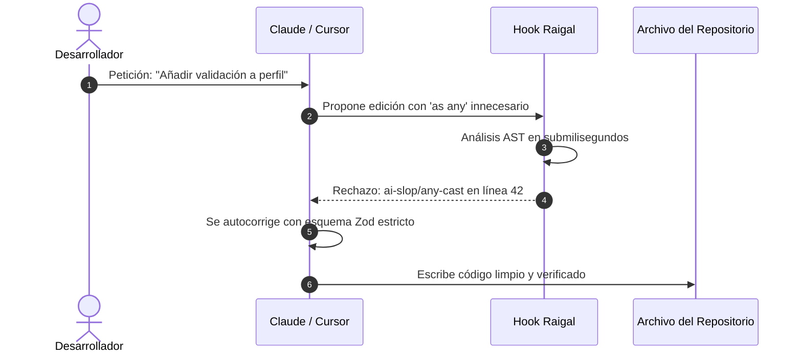

# Hooks de intercepción para agentes

Raigal puede analizar los cambios propuestos por agentes de programación antes de que se guarden en el disco.

## Funcionamiento de los hooks

Cuando un agente intenta modificar un archivo:
1. El hook ejecuta un análisis AST rápido sobre el búfer modificado.
2. Si el cambio introduce problemas como comprobaciones de nulos redundantes o eliminación de control de errores, el hook rechaza la edición o emite un aviso.
3. El agente recibe el mensaje de diagnóstico en su contexto y corrige el código propuesto.



## Instalación de hooks

Instale los hooks para todas las herramientas detectadas en el sistema:

```bash
raigal hook install
```

O configure herramientas específicas:

```bash
raigal hook install claude cursor opencode
```

## Estado y línea base

Compruebe el estado de los hooks:

```bash
raigal hook status
```

Guarde la puntuación actual como referencia base del proyecto:

```bash
raigal hook baseline
```

Las ediciones posteriores del agente que reduzcan la puntuación por debajo de esta base serán rechazadas.


Para conectar las herramientas de Raigal directamente al flujo de llamadas de herramientas del agente en lugar de usar hooks de archivos, consulte el [Servidor MCP de Raigal](../automatizacion-y-ci-cd/servidor-mcp.md).

